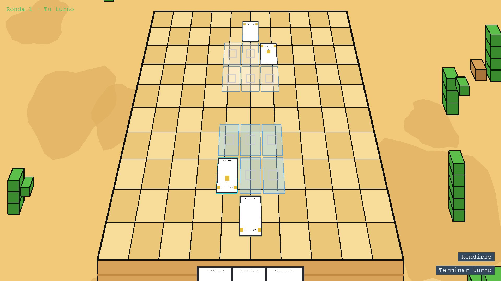
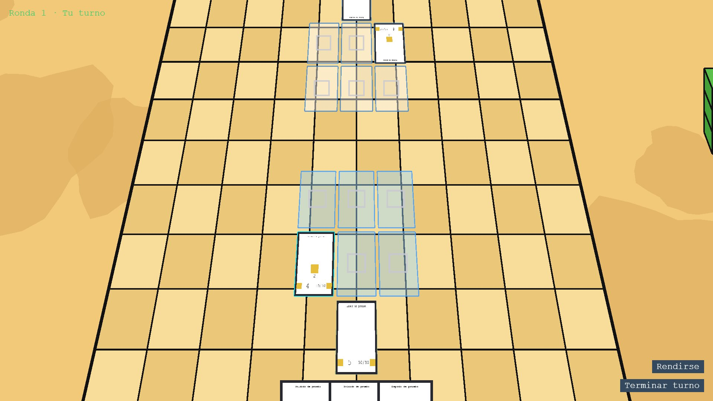

# Desert

A platform of sand blocks on sandstone, in a desert of dunes with block cacti and rocks. A battlefield of the arcade-blocks style, chosen on 2026-11-15 from the candidates (`Desierto`).

The code is in `battlefield.ts`, which holds every exact value; this file gives the colors and the main sizes. Sizes are in board units and `h` is half the side of the board (`../../README.md`).

## Surroundings

- Sand `#f2c879` with 50 dunes of 300 to 800 units, `#e0b060` or `#f7d898` at 70%.
- Up to 26 cacti in the part seen: three to five stacked green blocks of 120 to 180 units, `#5cbf4a` with faces of `#3a8a2e` and `#46a038`, some with an arm. Up to 20 rocks: blocks of 160 units, `#d9a25a`, `#a8743a` and `#bd8a48`. Every block has a black outline of 3 units.

## Edges

- A block of sandstone 160 units deep, `#d9a25a` and `#bd8a48`, with two layers `#c08840` and `#a8743a`.

## Surface

- A checkerboard of 10 by 10, `#f7dc9a` and `#ebc77a`, with black lines.
