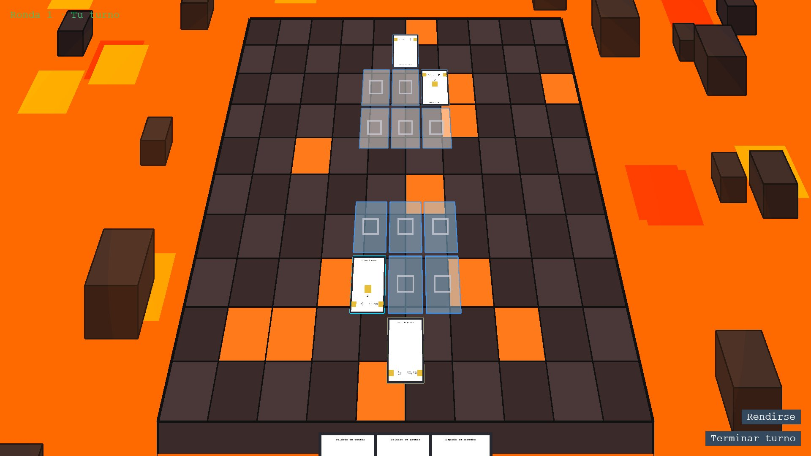
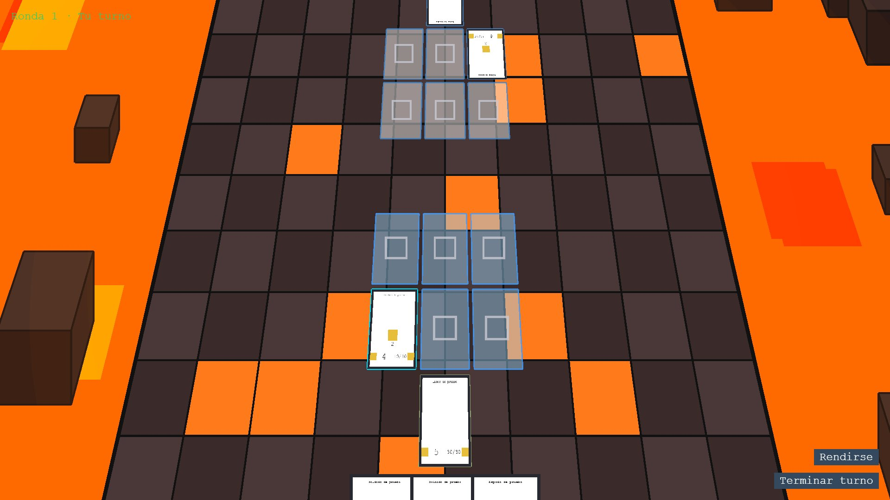

# Volcano

A platform of basalt blocks with glowing lava blocks, in a sea of lava with rocks sinking in it. A battlefield of the arcade-blocks style, chosen on 2026-11-15 from the candidates (`Volcán`).

The code is in `battlefield.ts`, which holds every exact value; this file gives the colors and the main sizes. Sizes are in board units and `h` is half the side of the board (`../../README.md`).

## Surroundings

- Lava `#ff6a00` with 80 squares of 440 units, `#ffb000` or `#ff3a00`.
- Up to 30 rocks in the part seen: blocks of 200 to 400 units, `#3a2a2a`, `#241818` and `#2e2020`, sunk 60% of their size.
- An orange glow of 2.2 `h` at 35% around the platform.

## Edges

- A block of basalt 220 units deep, `#3a2a2a` and `#2e2020`, with two layers, `#ff6a00` and `#241818`.

## Surface

- A checkerboard of 10 by 10, `#4a3838` and `#3a2a2a`, where about one block in eight is lava `#ff7a1a`, with black lines.
