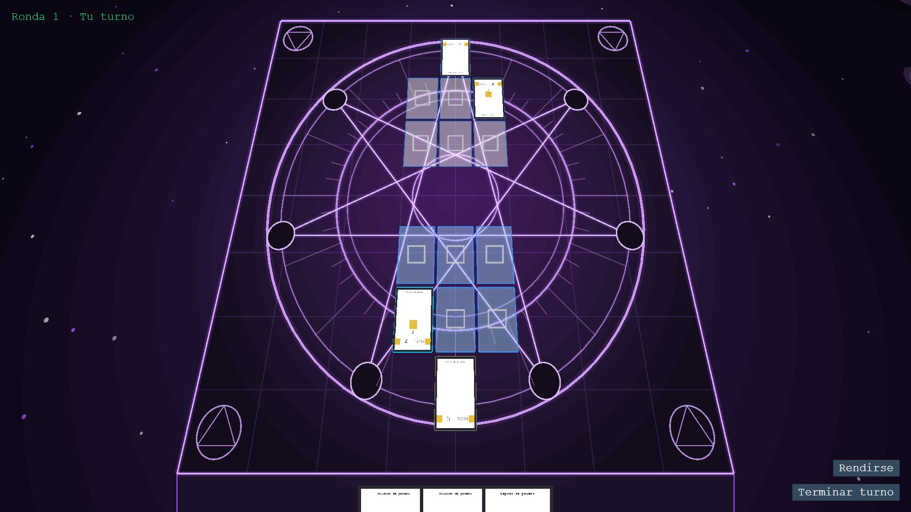
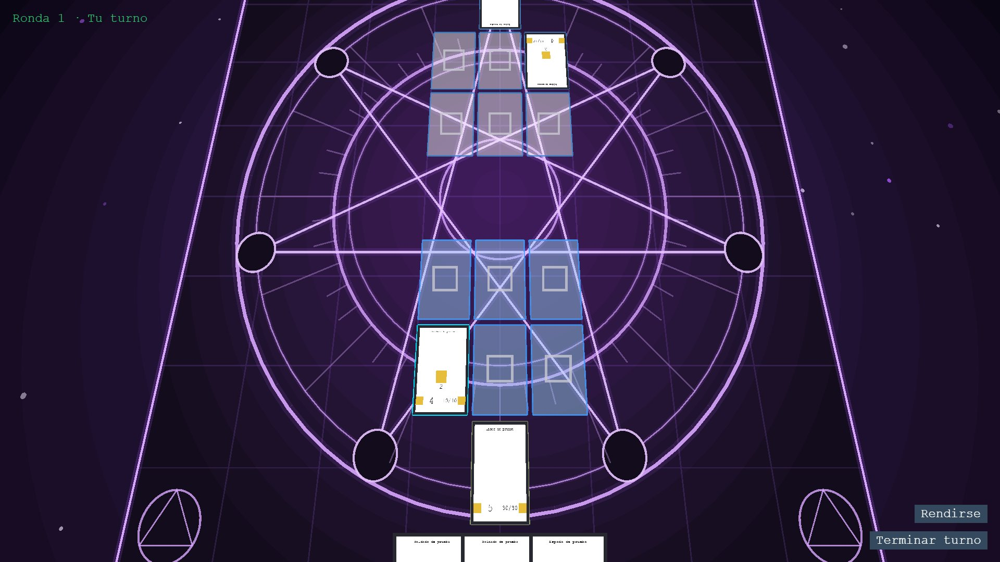

# Arcane altar in the void

An obsidian floor with a large violet magic circle, a seven-pointed star and sigils at the corners, floating in a starry void with rocks. A battlefield of the fantasy style, chosen on 2026-11-15 from the candidates (`Altar arcano en el vacío`).

The code is in `battlefield.ts`, which holds every exact value; this file gives the colors and the main sizes. Sizes are in board units and `h` is half the side of the board (`../../README.md`).

## Surroundings

- Void `#0b0614` with 300 small stars, violet `#b05cff` or white, from 30% to 80%.
- 26 floating rocks of 150 to 430 units, `#2a1d38` with a lighter face of `#3b2a50` and a shadow below.
- A violet glow of 2 `h` around the board, at 30%.

## Edges

- Bands of 140 units, `#150d20` on the sides and `#1b1128` on the near edge, outlined with 2 units of `#b05cff`.

## Surface

- Obsidian `#120c1c` with a grid every 0.25 `h` of 2 units of `#2a1d40`.
- A violet glow of 1.1 `h` at 35% in the middle.

## Marks

- Five rings, at 0.86, 0.8, 0.55, 0.5 and 0.2 `h`, each one a line of `#d9a6ff` over a glow of `#b05cff` at 12% three times wider.
- A star of seven points at 0.8 `h`, drawn joining every third point: a line of 3 units of `#e6c4ff` over a glow of 10 units of `#b05cff`. A circle of 0.06 `h` of obsidian with an outline of `#e6c4ff` on each point.
- 48 radial ticks between 0.55 `h` and 0.62 `h`, every third one reaching 0.8 `h`, 2 units of `#d9a6ff` at 35%.
- At each corner, at 0.88 `h`: a ring of 0.08 `h` and a triangle inside it, `#d9a6ff`.
- An outline of 3 units of `#d9a6ff` on a glow of 10 units of `#b05cff`.
