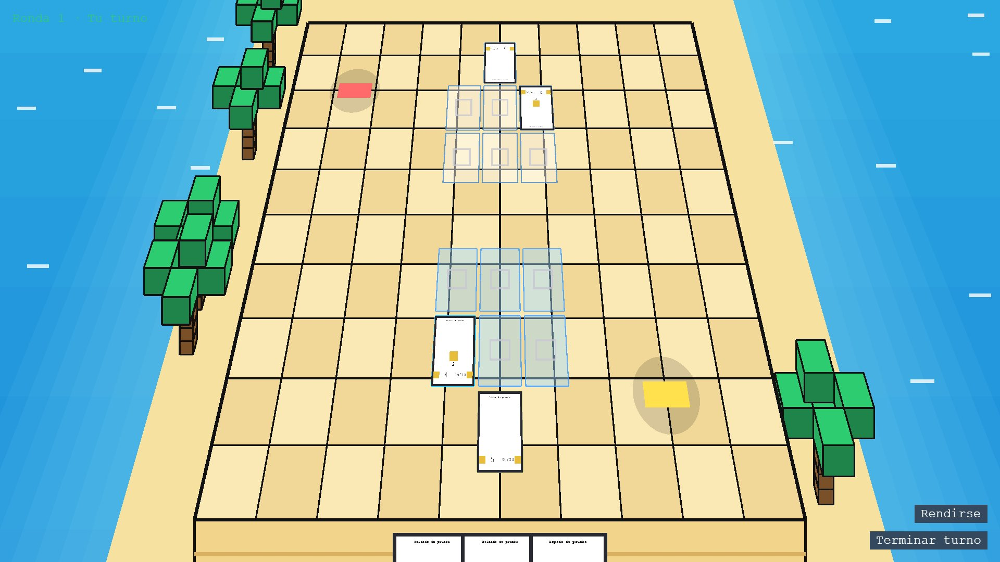
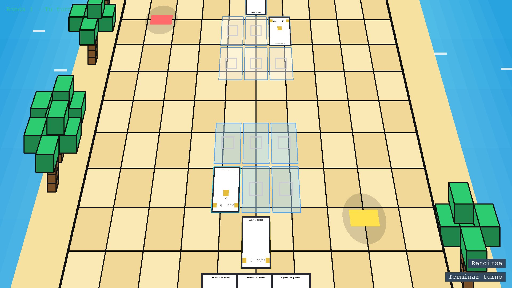

# Beach

A platform of sand blocks on a strip of beach with block palms, a towel and a parasol, in a sea of blue. Chosen on 2026-11-15 from the candidates (`Playa`).

The code is in `battlefield.ts`, which holds every exact value; this file gives the colors and the main sizes. Sizes are in board units and `h` is half the side of the board (`../../readme.md`).

## Surroundings

- Sea shading from `#3ac0e8` at the far end to `#1a8ad8` at the near one, lighter near the shore with eight bands of `#7fdcf0` at 8%, and 160 crests of foam of 140 units, white at 80%.
- Beach `#f7e1a0` 400 units around the board, with up to 16 palms: a trunk of five blocks of 80 units, `#a0703a`, and a crown of five blocks of 160 units, `#2ecc71`, at 400 units of height.

## Edges

- A block of sand 120 units deep, `#f2d48a` and `#e0c070`, with a layer of `#d8b060`.

## Surface

- A checkerboard of 10 by 10, `#fbe9b5` and `#f2d898`, with black lines.
- A red towel `#ff6b6b` at (-0.7 `h`, -0.6 `h`) and a yellow parasol `#ffe14d` at (0.6 `h`, 0.65 `h`), each with a round shadow of 0.12 `h`.
