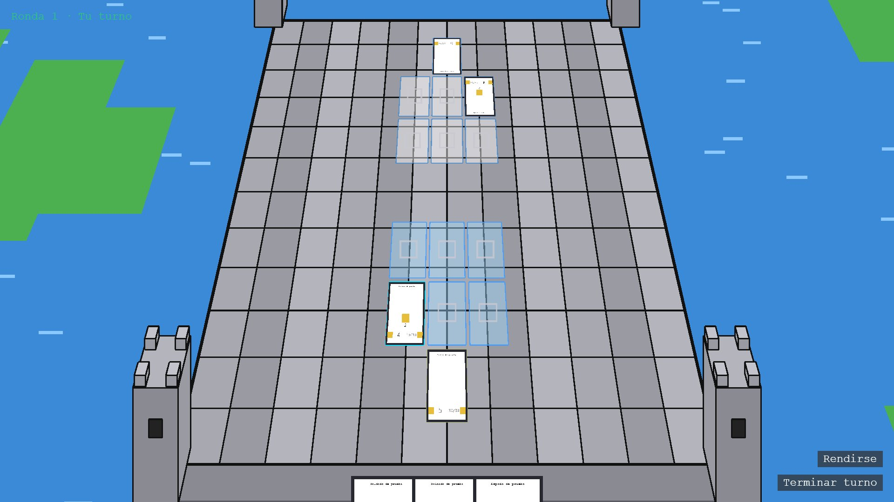
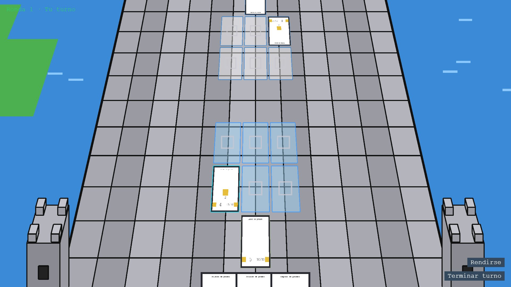

# Castle with a moat

A courtyard of stone blocks with a tower at each corner, surrounded by a moat of water with patches of grass beyond. Chosen on 2026-11-15 from the candidates (`Castillo con foso`).

The code is in `battlefield.ts`, which holds every exact value; this file gives the colors and the main sizes. Sizes are in board units and `h` is half the side of the board (`../../README.md`).

## Surroundings

- Water `#3a8ad8` with 140 waves of 160 units, 6 units of `#8ac8ff`, and 30 squares of grass of 800 units, `#4caf50`, beyond 900 units of the board.

## Edges

- A wall 150 units deep, `#8a8a92` and `#74747c`, with a layer of `#5a5a62`.

## Surface

- A grid of 12 by 12 stone blocks in `#a8a8b0`, `#9a9aa2` and `#b4b4bc`, with black lines.

## Marks

- A tower at each corner, centered 0.032 `h` outside it: a block of 0.16 `h` square and 0.416 `h` tall, `#b4b4bc`, `#8a8a92` and `#9a9aa2`, with four merlons of 0.04 `h` on top and a black window on its near face.
