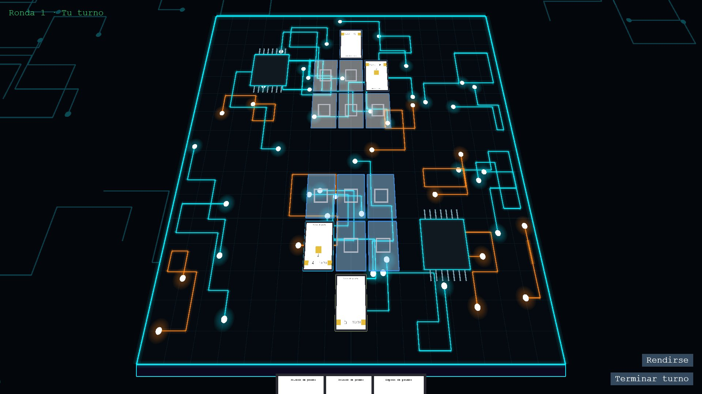
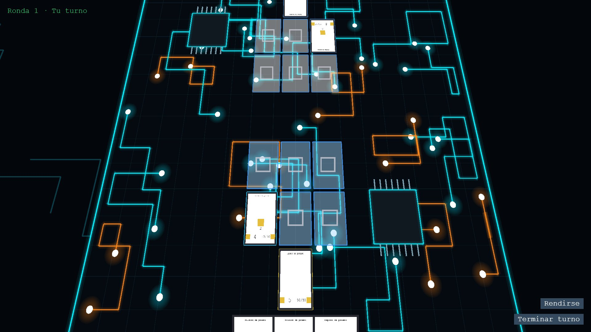

# Circuit board

A black board with glowing cyan and orange traces, solder pads and two chips, over a dark floor with faint traces. A battlefield of the neon style, chosen on 2026-11-15 from the candidates (`Placa de circuitos`).

The code is in `battlefield.ts`, which holds every exact value; this file gives the colors and the main sizes. Sizes are in board units and `h` is half the side of the board (`../../README.md`).

## Surroundings

- Black `#03070c` with 60 traces of four turns of up to 500 units, 3 units of `#0a4a55` at 80%, each ending in a pad of 30 units.

## Edges

- Bands of 30 units of `#0b0820` outlined with 2 units of `#00f0ff`.

## Surface

- `#050a10` with a grid every 0.125 `h` of 1 unit of `#0c1a24`.
- 26 traces of six turns of up to 0.27 `h`, every fourth one orange `#ff8a1a` and the rest cyan `#00f0ff`. A neon line is a core of 2 units at 95% over glows of 6 units at 16% and 12 units at 7%. Each trace ends in a pad: a glow of 0.05 `h` and a white dot of 0.015 `h`.
- Two chips of 0.24 `h`, `#101820`, outlined in cyan, with seven pins of `#7aa0b0` on two sides.

## Marks

- A cyan neon outline with a core of 3 units.
