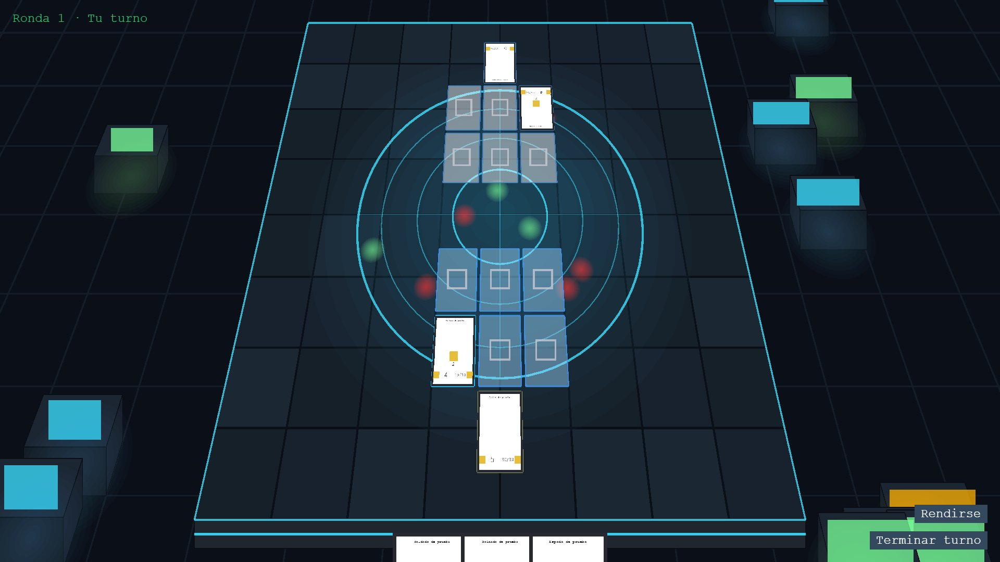
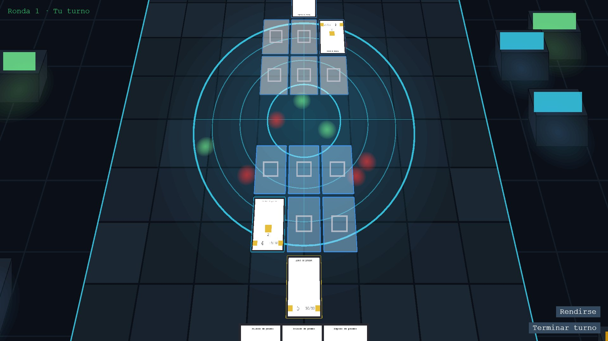

# Command bridge

A floor of dark blue panels with a holographic tactical display in the middle, between consoles with glowing screens. Chosen on 2026-11-15 from the candidates (`Puente de mando`).

The code is in `battlefield.ts`, which holds every exact value; this file gives the colors and the main sizes. Sizes are in board units and `h` is half the side of the board (`../../README.md`).

## Surroundings

- Floor `#0b1018` with lines every 500 units of 3 units of `#141c28`.
- Up to 26 consoles around the board, within 1300 units of it: boxes of 440 by 240 units and 260 tall, `#1c2633`, `#141c26` and `#18202b`, with a screen on top in cyan `#3ae0ff`, amber `#ffb000` or green `#7aff9a` at 75%, and a glow of its color of 300 units at 20%.

## Edges

- Bands of 50 units, `#1a2027` on the sides and `#1f262e` on the near edge, outlined with 2 units of `#0b0f13`, and a cyan strip of 4 units along the near band.

## Surface

- A grid of 8 by 8 panels on seams `#0b1018`, each one `#18222e`, `#1c2734` or `#152029`.
- A cyan glow of 0.8 `h` at 25% in the middle.

## Marks

- Rings of `#3ae0ff` at 0.6, 0.5, 0.35 and 0.2 `h`, and a cross of 1.2 `h`, from 1.5 to 4 units.
- Up to nine blips inside the display, glows of 0.05 `h`, red `#ff3b30` or green `#7aff9a`.
- A cyan outline of 3 units at 80%.
