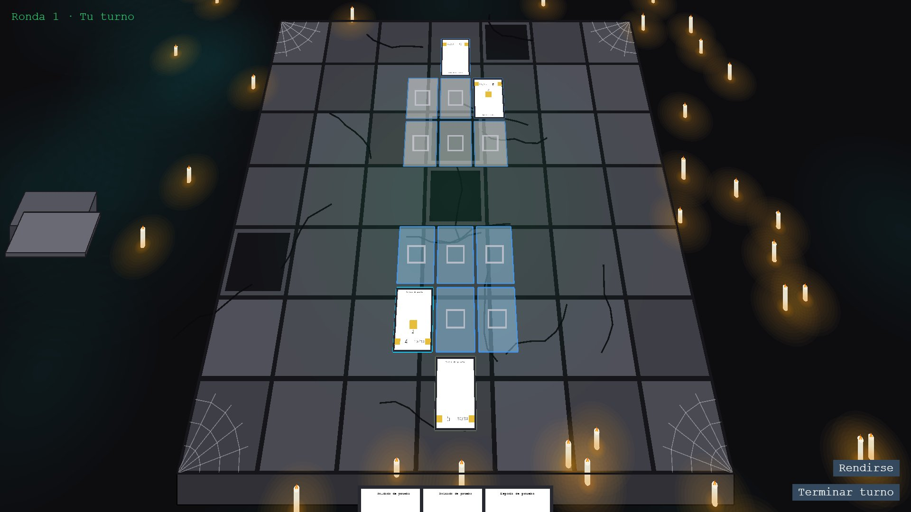
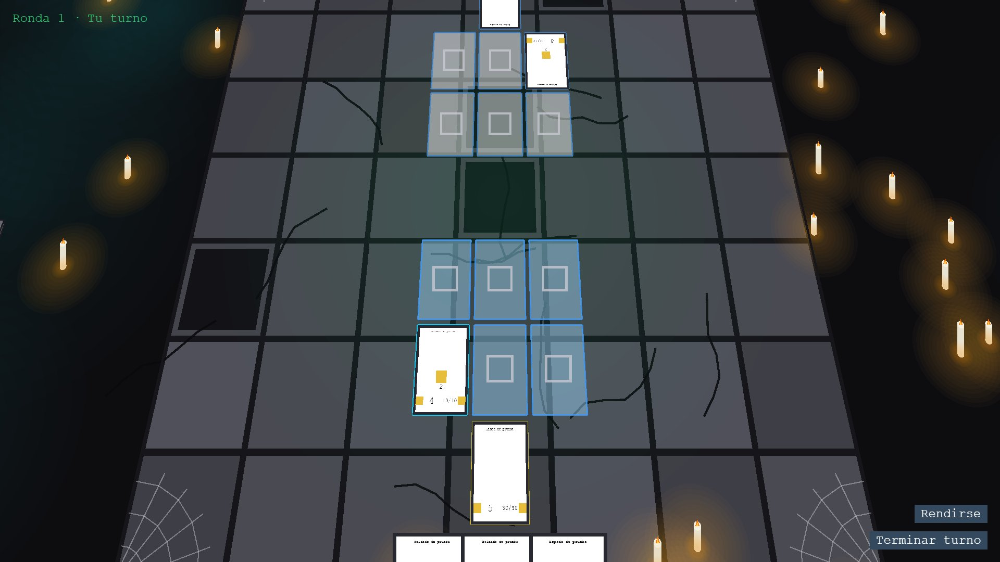

# Crypt

Cracked slabs of grey stone, some missing, with cobwebs on the corners and candles around, in a dark crypt with sarcophagi and green mist. Chosen on 2026-11-15 from the candidates (`Cripta`).

The code is in `battlefield.ts`, which holds every exact value; this file gives the colors and the main sizes. Sizes are in board units and `h` is half the side of the board (`../../readme.md`).

## Surroundings

- Darkness `#0d0d10` with 40 glows of green mist `#3cff9a` at 8%, from 500 to 1100 units of radius.
- Up to 10 sarcophagi outside the board: a box of 520 by 240 units and 200 tall, `#55555f`, `#3a3a42` and `#44444d`, with a lid of 560 by 280 and 30 tall, `#6a6a74`, `#4a4a52` and `#55555f`, outlined with 2 units of `#1a1a1f`.

## Edges

- Bands of 60 units, `#2a2a30` on the sides and `#303036` on the near edge, outlined with 2 units of black.

## Surface

- A grid of 7 by 7 slabs, 3% of their side apart, on mortar `#15151a`; each one `#4a4a52`, `#44444c`, `#50505a` or `#3e3e46`.
- Four slabs missing: dark `#0a0a0d` at 85%, 40 units inside their edges.
- 14 cracks of 0.35 `h` in 6 turns, 3 units of `#0a0a0d` at 90%.

## Marks

- A cobweb on each corner: six threads of 0.25 `h` and three arcs at 0.08, 0.15 and 0.22 `h`, 1.5 units of `#d0d0d8` at 45%.
- Candles on the border of the board and around it, beyond 0.85 `h` from the middle: a warm glow of 220 units at 30%, a candle of 16 units of radius and 60 to 140 tall, `#e8e2d0`, and a flame.
- A green glow of 0.9 `h` at 10% in the middle, and an outline of 3 units of `#15151a`.
