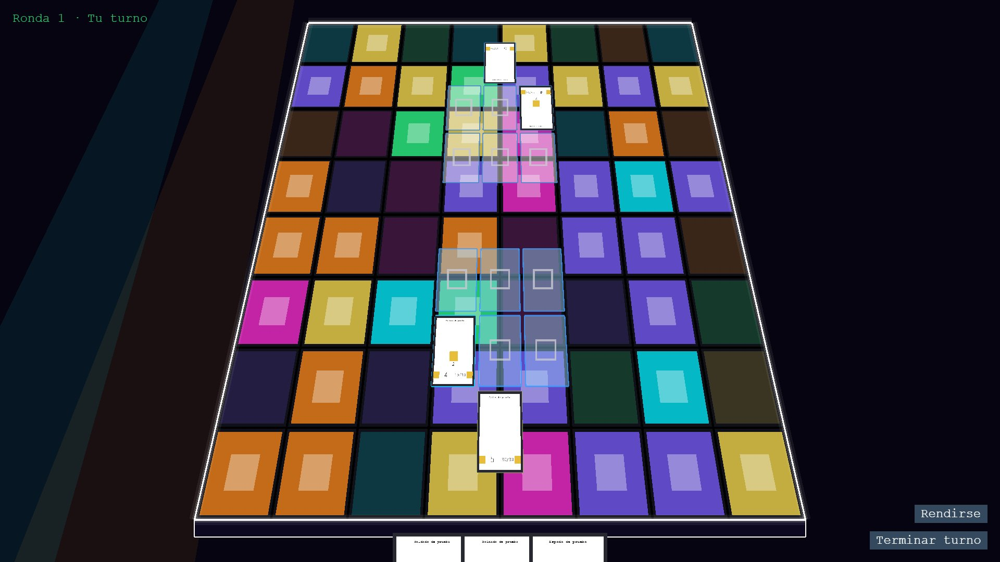
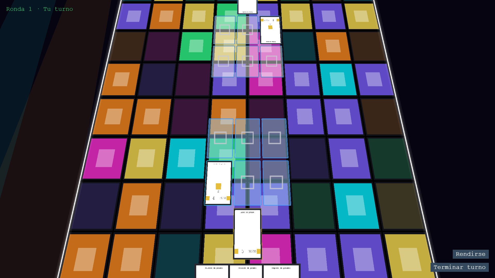

# Dance floor

A floor of glowing tiles of six colors, two thirds of them lit, under colored light beams in the dark. Chosen on 2026-11-15 from the candidates (`Pista de baile`).

The code is in `battlefield.ts`, which holds every exact value; this file gives the colors and the main sizes. Sizes are in board units and `h` is half the side of the board (`../../README.md`).

## Surroundings

- `#060410` with 12 beams of light: a triangle from the far end of the ground to each spot, 1000 units wide, at 8%, and a glow of 700 units at 25%, in magenta, cyan, yellow, violet `#7a5cff`, green `#2bff88` or orange.

## Edges

- Bands of 30 units of `#0b0820` outlined with 2 units of white.

## Surface

- `#101018` under a checkerboard of 8 by 8 tiles, 5% of their side apart, each one of a random color of the six. Two thirds of them are lit, at 75% with a white center at 35% of 40% of the tile; the rest at 18%.
- Black lines of 4 units between the tiles.

## Marks

- A white neon outline with a core of 3 units.
