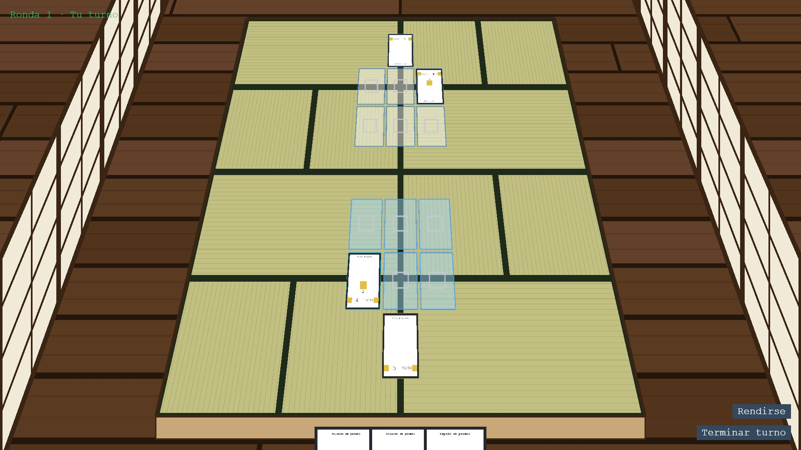
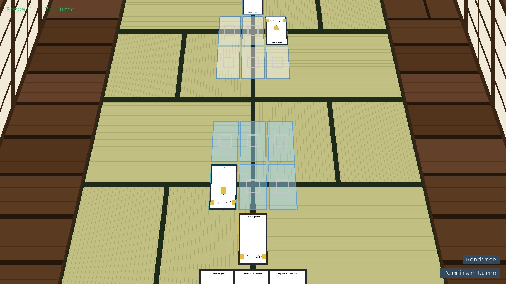

# Dojo

Straw mats with dark borders laid in a classic pattern, on a floor of dark planks between walls of paper screens. Chosen on 2026-11-15 from the candidates (`Dojo`).

The code is in `battlefield.ts`, which holds every exact value; this file gives the colors and the main sizes. Sizes are in board units and `h` is half the side of the board (`../../readme.md`).

## Surroundings

- A floor of 28 rows of staggered planks across, `#5a3a20`, `#62402a` or `#52341c`, on seams `#24160a`.
- A wall of paper screens on each side, 900 units outside the board, six panels of 0.55 `h` from -1.6 `h` and 1300 units tall: paper `#f2ead8` in a frame of 10 units of `#3a2414`, with three bars across and one up the middle of 4 units.

## Edges

- Bands of 50 units, `#b89868` on the sides and `#c8a878` on the near edge, outlined with 3 units of `#3a2414`.

## Surface

- Mats on `#2a1e10`, in four rows of `h/2`: in turns, one mat of `h` by `h/2` across, or two of `h/2` by `h/2`. Each mat `#cfc48a` with `#9ab06a` at 25% over it, 6 units inside its place, with 23 lines of weave of 1 unit of `#8a7a4a` at 35% along it, and a border of 10 units of `#1e2a1a`.

## Marks

- An outline of 6 units of `#3a2414`.
