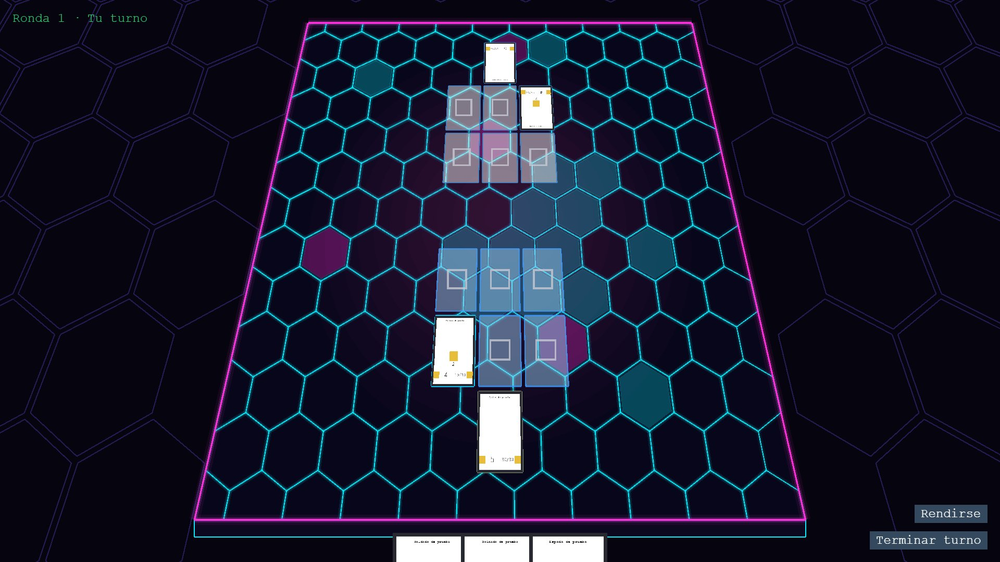
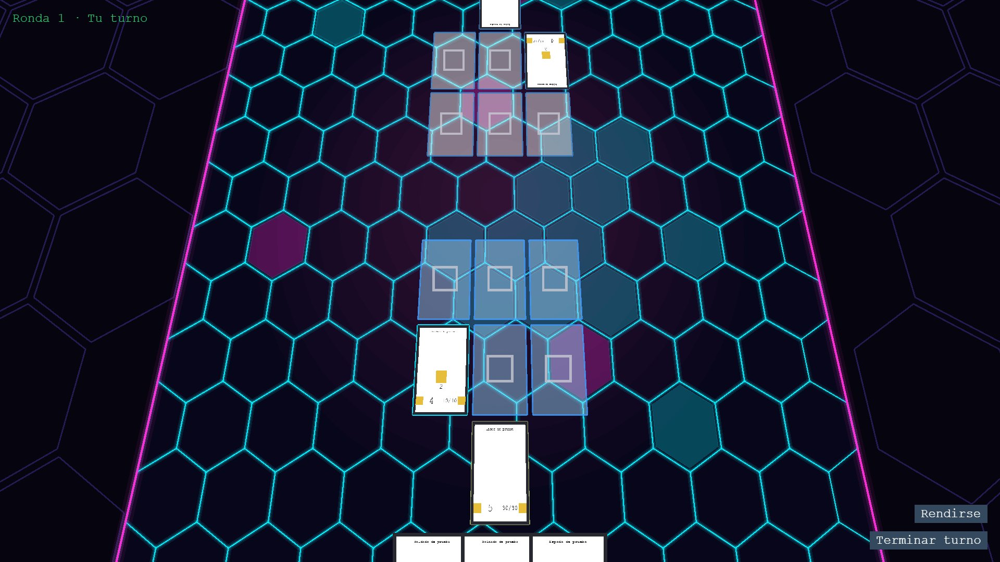

# Hexagons

A dark floor of cyan neon hexagons, some of them filled with cyan or magenta, under a magenta glow, over a floor of faint violet hexagons. Chosen on 2026-11-15 from the candidates (`Hexágonos`).

The code is in `battlefield.ts`, which holds every exact value; this file gives the colors and the main sizes. Sizes are in board units and `h` is half the side of the board (`../../readme.md`).

## Surroundings

- `#05040f` with hexagons of 400 units of radius, 2 units of `#3a2a80` at 60%, left out within 200 units of the board.

## Edges

- Bands of 30 units of `#0b0820` outlined with 2 units of `#00f0ff`.

## Surface

- `#08061a` with a grid of hexagons of 0.11 `h` of radius, pointy side up, in cyan neon with a core of 1.5 units at 80% of the usual glow.
- One hexagon in five, chosen at random and away from the edge, filled at 28%: magenta `#ff2bd6` or cyan `#00f0ff`.
- A magenta glow of 0.8 `h` at 20% in the middle.

## Marks

- A magenta neon outline with a core of 3 units.
