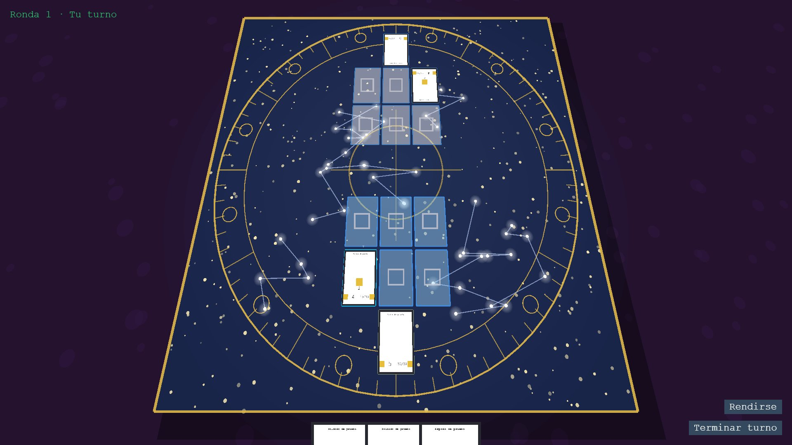

# Star chart

A navy star chart with gold rings, a zodiac band, constellations and a sky of stars, spread on purple velvet. A battlefield of the parchment style, chosen on 2026-11-15 from the candidates (`Mapa celeste`).

The code is in `battlefield.ts`, which holds every exact value; this file gives the colors and the main sizes. Sizes are in board units and `h` is half the side of the board (`../../README.md`).

## Surroundings

- Velvet `#24122e` with 400 spots of `#2e1840` at 60%.
- A shadow under the chart, 60 units to the right and down, black at 35%.

## Surface

- Navy `#182448` with a glow of `#2a3a6a` of 1.2 `h` at 60% in the middle.
- 500 stars of 4 to 13 units, `#f5e6b0`, from 40% to 100%.

## Marks

- Rings of `#e0b84a` at 0.95 `h`, 4 units, and 0.8 `h`, 2 units. Between them, 72 ticks every 5°, every sixth one long, and 12 small circles of 0.035 `h` for the zodiac.
- Nine constellations of five stars each: lines of 2 units of `#bfd4ff` at 60%, and each star a white disc of 12 units with a glow of 0.03 `h`.
- A ring of 0.25 `h` and a cross of 0.7 `h`, gold at 50% and 60%, and a gold outline of 6 units on the edge.
