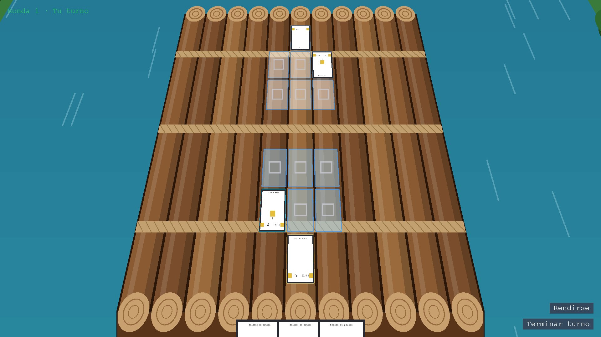
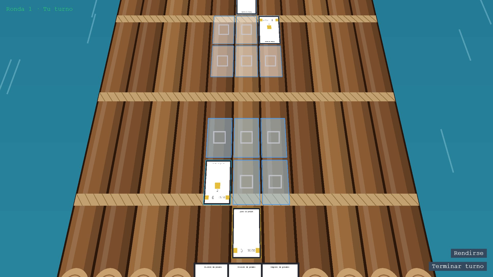

# Raft on a river

A raft of eleven logs bound with three ropes, floating on a blue river between green banks with trees. Chosen on 2026-11-15 from the candidates (`Balsa en el río`).

The code is in `battlefield.ts`, which holds every exact value; this file gives the colors and the main sizes. Sizes are in board units and `h` is half the side of the board (`../../readme.md`).

## Surroundings

- A river shading from `#1e6a8a` at the far end to `#2a8aa0` at the near one, with 160 lines of current of 400 units, 4 units of `#a8e0f0` at 35%.
- Green banks `#3a7a3a` 1500 units wide at both ends across, with trees beyond 1700 units of the board: a trunk of 40 units of radius and 300 tall and two crowns, `#1e4a1e` and `#2e6a2e`.

## Edges

- Bands of 110 units, `#4a2a12` on the sides and `#5a3418` on the near edge, outlined with 3 units of `#1e1008`.

## Surface

- Eleven logs from the far edge to the near one, on `#2a170a`, in turns of `#8a5a32`, `#7a4e2c` and `#9a6a3c`, each one with a light band of 16% of its width at 12% and a shadow band of 24% at 20%.
- The end of each log at both edges: a disc of 46% of its width of `#c8a070` with two rings of `#8a5a32`.

## Marks

- Three ropes across, at -0.6, 0 and 0.6 `h`, 0.06 `h` wide, `#c2a070` with a twist of 40 strokes of `#8a6a3a`.
