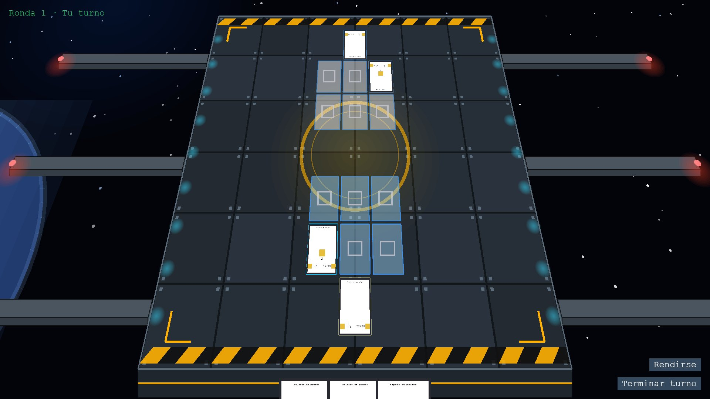
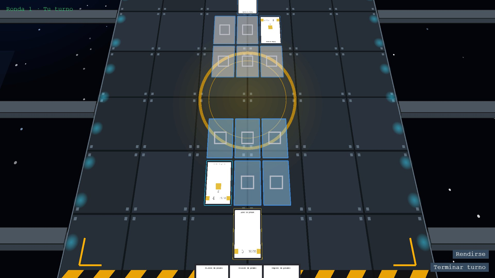

# Hangar in space

A deck of metal plates with hazard stripes and a landing ring, held by struts with red beacons in open space, next to a blue planet. A battlefield of the sci-fi style, chosen on 2026-11-15 from the candidates (`Hangar en el espacio`).

The code is in `battlefield.ts`, which holds every exact value; this file gives the colors and the main sizes. Sizes are in board units and `h` is half the side of the board (`../../README.md`).

## Surroundings

- Space `#03040a` with 500 stars of 5 to 14 units, white or `#aad4ff`, and five nebulas of 900 to 1800 units at 25%, violet `#5a2a8a`, blue `#1a4a8a` or magenta `#8a2a5a`.
- A planet of 1500 units of radius at the left, `#2a4a8a`, lit from the left with a band from `#5a8ad0` to `#10203a` at 35% and a rim of 18 units of `#8ac0ff` at 15%.
- Three struts on each side, at -0.6, 0.1 and 0.8 `h`, 1600 units long, 120 wide and 60 tall, `#4a5560`, `#343c45` and `#3c454f`, each one ending in a red beacon `#ff3b30` with a glow of 160 units.

## Edges

- Bands of 70 units, `#1a2027` on the sides and `#1f262e` on the near edge, outlined with 2 units of `#0b0f13`, and a strip of 4 units of `#ffb000` along the middle of the near band.

## Surface

- A grid of 6 by 6 plates, 1.5% of their side apart, on seams `#12171c`, each one `#262e37`, `#2a333d` or `#232a32`, with a rivet near each corner: a square of 0.016 `h` of `#5c6b7a`.
- Hazard stripes along the far and near edges, from 0.02 to 0.08 `h` inside them, of 24 slanted stripes, `#ffb000` and `#111111` at 90%.

## Marks

- A landing ring of 0.32 `h`, 8 units of `#ffb000` at 60%, an inner ring of 0.26 `h`, and an amber glow of 0.5 `h` at 20%.
- Corner brackets at 0.9 `h`, arms of 0.12 `h`, 5 units of amber.
- Nine cyan lights `#3ae0ff` along each side edge, at 0.97 `h`, every 0.2 `h`.
- An outline of 3 units of `#5c6b7a`.
