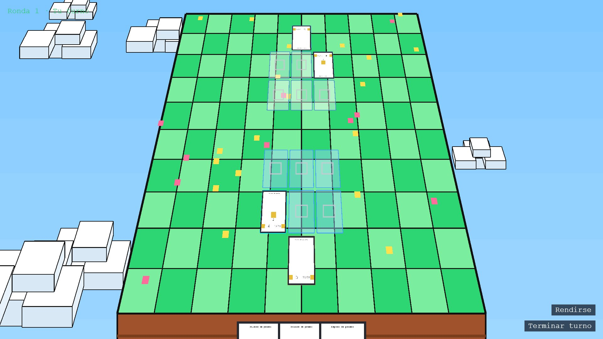
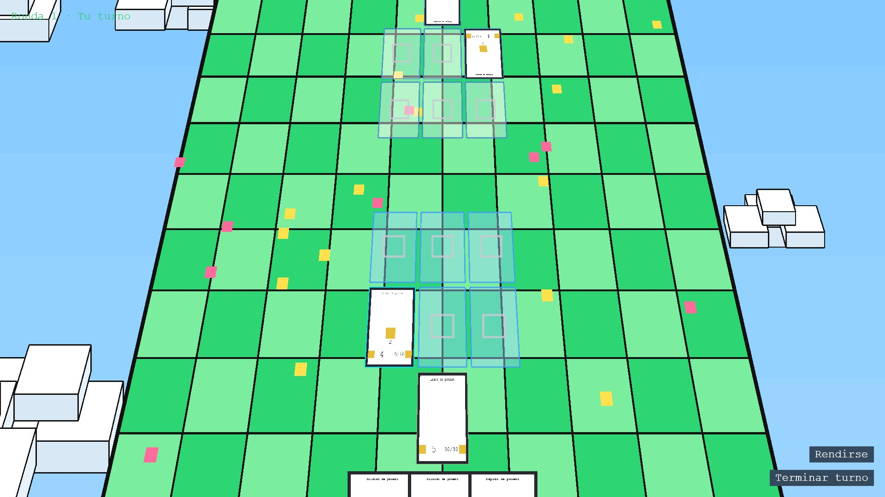

# Floating island in the sky

A platform of grass blocks over layers of dirt and stone, floating in a blue sky among block clouds, with small flowers. Chosen on 2026-11-15 from the candidates (`Isla flotante en el cielo`).

The code is in `battlefield.ts`, which holds every exact value; this file gives the colors and the main sizes. Sizes are in board units and `h` is half the side of the board (`../../README.md`).

## Surroundings

- Sky shading from `#5ab4ff` at the far end to `#a8dcff` at the near one.
- Up to 26 clouds in the part of the surroundings seen at the start zoom (from -3800 to 3800 across and from -3400 to 2400 in depth): four white blocks each, `#ffffff` with faces of `#d8e8f5` and `#e8f2fa`, 220 to 480 units, at a height from -200 to 400.

## Edges

- A block of dirt 260 units deep: `#a0522d` on the near edge and `#8b4513` on the sides, outlined with 5 units of `#111111`, with three layers of 8 units across the near band, `#7a3e1d`, `#6a6a6a` and `#7a3e1d`.

## Surface

- A checkerboard of 10 by 10, `#2ed573` and `#7bed9f`, with black lines of 3 units between the blocks and 6 units on the edge.
- 30 flowers: squares of 60 units, yellow `#ffe14d` or pink `#ff6b9a`.
