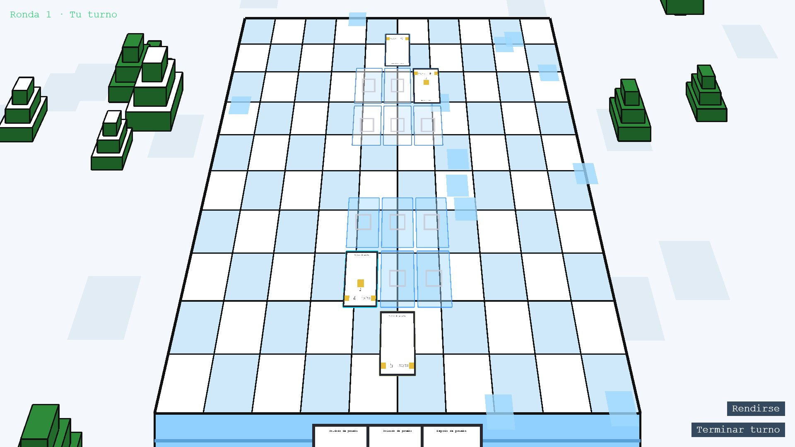
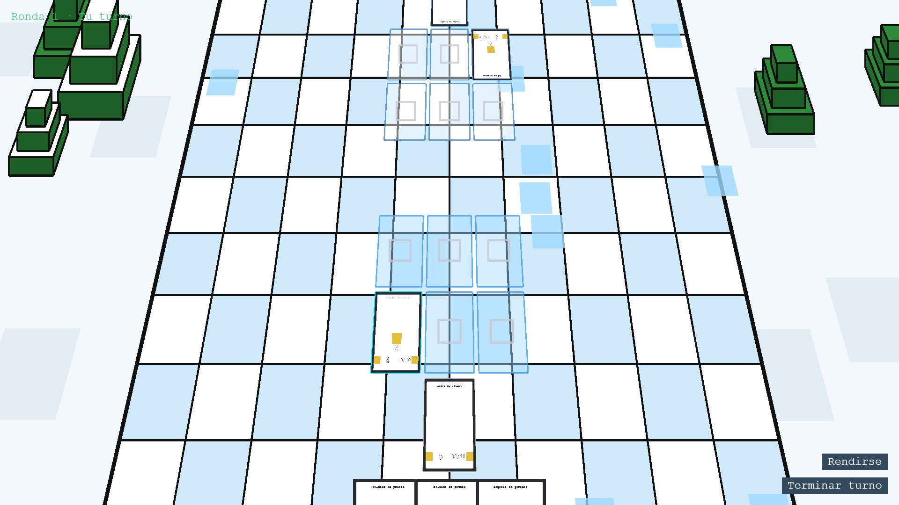

# Snow

A platform of snow and ice blocks over ice, in a snowy field with block pines. Chosen on 2026-11-15 from the candidates (`Nieve`).

The code is in `battlefield.ts`, which holds every exact value; this file gives the colors and the main sizes. Sizes are in board units and `h` is half the side of the board (`../../README.md`).

## Surroundings

- Snow `#f4f8fc` with 60 patches of 400 units of `#e2ecf5`.
- Up to 40 pines in the part seen, 260 to 400 units: a trunk block `#7a4e2c` and three tiers of green `#2e8b3a` with faces `#1d5e26` and `#236b2d`, half of them with white snow on the tops.

## Edges

- A block of ice 180 units deep, `#8fd0ff` and `#6ab8f0`, with two layers `#5aa0d8` and white.

## Surface

- A checkerboard of 10 by 10, white and `#cfe9fb`, with black lines, and 12 patches of ice of 180 units of `#9fd8ff` at 80%.
