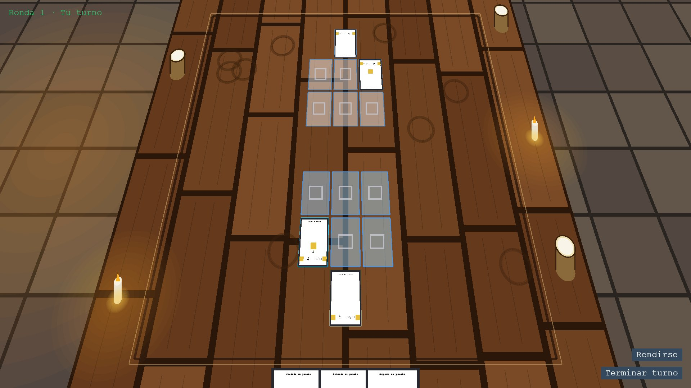
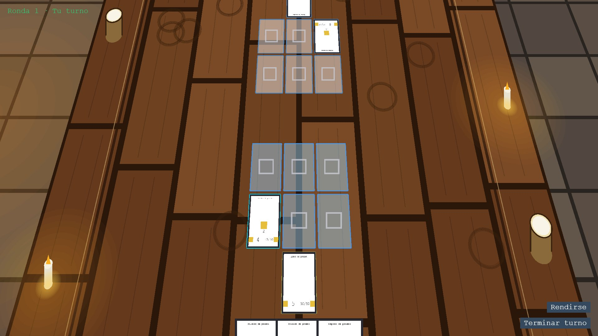

# Tavern table

A tabletop of long planks wider than the board, with ring stains of mugs, candles and plates, on a stone floor warmed by a hearth. A battlefield of the wood style, chosen on 2026-11-15 from the candidates (`Mesa de taberna`).

The code is in `battlefield.ts`, which holds every exact value; this file gives the colors and the main sizes. Sizes are in board units and `h` is half the side of the board (`../../README.md`).

## Surroundings

- Stone slabs of 600 units, 15 units apart, in `#5a4e44`, `#524740` or `#62564a`, on joints `#2a2420`.
- A warm glow of `#ff8a2a` at 35% of 1800 units, 1200 units left of the board, as a hearth out of sight.

## Edges

- Bands of 160 units of `#3b2410`, outlined with 3 units of `#1a0e06`, hang from the left and right edges of the board, under the table, which reaches 1.28 `h` from the middle.

## Surface

- Planks running from the far edge to the near one, eight across the table, staggered, in `#6e4220`, `#7a4a26` or `#65391c`, on seams `#2a170a`, with two lines of grain each.
- The play area marked with a line of 6 units of `#2a170a` at 80% on the edge of the board and a brass line of 2 units of `#c9a66b` at 60%.
- Nine ring stains of mugs on the board, 0.08 `h` of radius, `#3a1e0a` at 40% and 30%.

## Marks

- On the margin of the table: three plates on a stand of 80 units of radius and 200 tall, `#8a6a3a` with a top of `#f0e0b0`; and two candles of 30 units of radius and 150 tall with a warm glow of 500 units.
