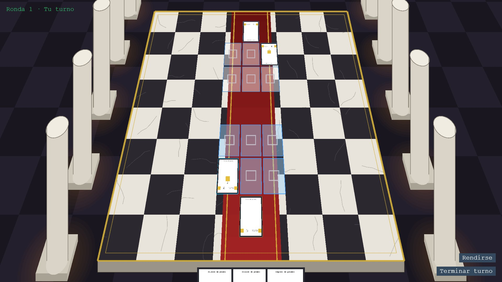
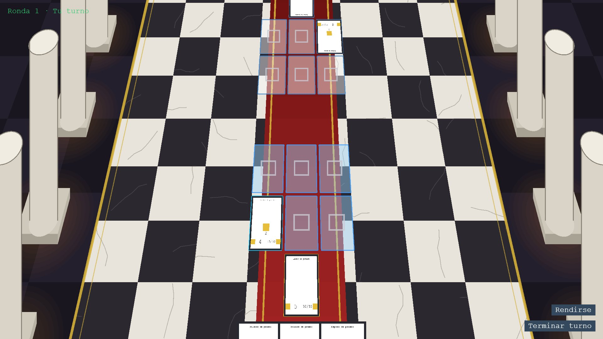

# Throne hall

A marble checkerboard with a red carpet down the middle and gold borders, between two rows of white columns, on a floor of dark tiles. Chosen on 2026-11-15 from the candidates (`Throne room hall`).

The code is in `battlefield.ts`, which holds every exact value; this file gives the colors and the main sizes. Sizes are in board units and `h` is half the side of the board (`../../readme.md`).

## Surroundings

- Tiles of 600 units, alternately `#241f2c` and `#1a1620`, without gaps.
- Two rows of five columns, 420 units outside the left and right edges, one every `h/2` from the far edge to the near one. Each column: a warm glow of `#ffb347` at 25% and 380 units of radius; a square base 320 units wide and 80 tall, top `#cfc9bb`, near face `#a8a294`, side `#b8b2a4`; and a shaft of 110 units of radius and 1400 tall, `#d9d4c7` with a top of `#f0ece2` and an outline of 2 units of `#8a8478`.

## Edges

- Bands of 40 units, `#8a8478` on the sides and `#9a9488` on the near edge, outlined with 2 units of `#3a362f`.

## Surface

- A checkerboard of 8 by 8, `#e8e4dc` and `#2b2830`, each square with a random vein of 1.5 units, `#8a8478` at 50% on the light ones and `#5a5560` on the dark ones.
- A carpet from -0.2 `h` to 0.2 `h` across the whole depth, shading from `#6a1010` at the far edge to `#a02222` at the near one, with two gold lines of 4 units at ±0.17 `h`.

## Marks

- A gold outline of 6 units of `#d4af37` at 90% on the edge, and another of 2 units at 60%, 0.96 `h` from the middle.
