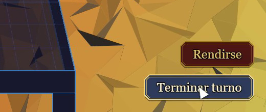
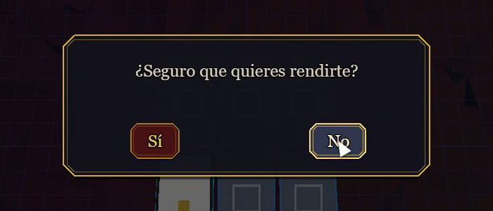

# Fantasy

Dark plates with cut corners and a double gold border that lights up under the pointer, with serif type. Prototype name: `fantasy` (`fantasia` in the recordings).

## Text

- Georgia, 24 px, regular, with a black outline of 3 px.
- Buttons: `#e8c872`, and `#fff6d8` under the pointer.
- Padding of the buttons: 22 px left and right, 10 px top and bottom.

## Buttons

  

- **Shape.** An octagon: a rectangle with its four corners cut 9 px.
- **Shadow.** The same shape, 3 px lower, black at 45%.
- **Fill**, at 96%: primary `#1d2a4a`, destructive `#4a1414`, neutral `#2b2b30`.
- **Border.** 2 px, `#9c7a26`.
- **Inner line.** 4 px inside the border, with corners cut 5.4 px, 1 px of `#d4af37` at 30%.
- **Under the pointer.** The border goes to `#f5d77a` and the inner line to 90%. The fill of the primary and neutral buttons goes halfway to `#3a4a70`; the destructive one gets `#7a1f1f` at 60% over it.

## Turn panel

- The shape of the buttons with its corners cut 16 px, fill `#14141c` at 95%, and a shadow 5 px lower, black at 50%.
- Border of 2.5 px of `#d4af37`, and an inner line 6 px inside it, 1 px of `#d4af37` at 50%, with corners cut 9.6 px.
- Text `#f5d77a` on the turn of the local player, `#d9d2c0` otherwise.

## Dialog

- The panel of the turn, at 520 by 200 px.
- Question in `#d9d2c0`. "Sí" uses the destructive button, "No" the neutral one.
