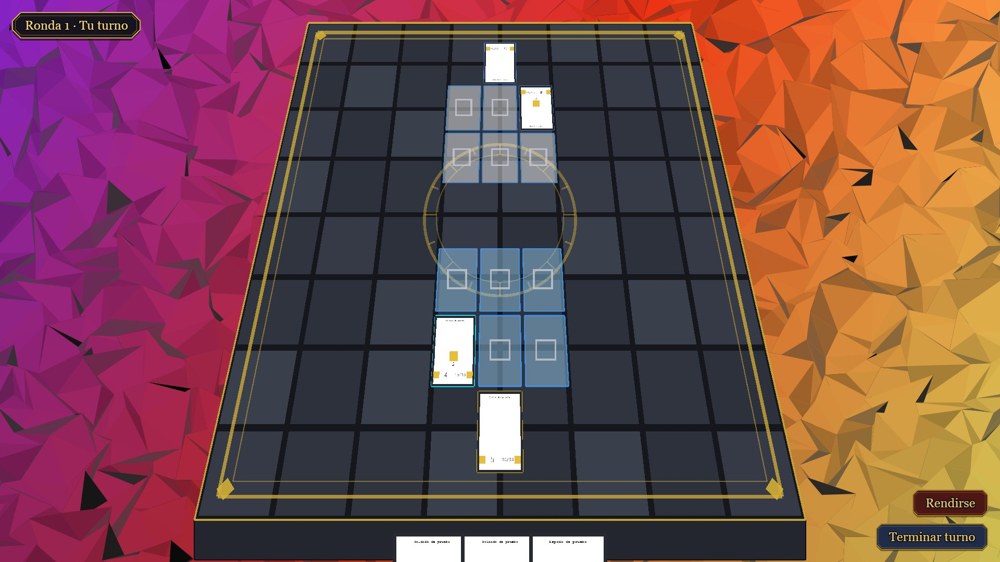
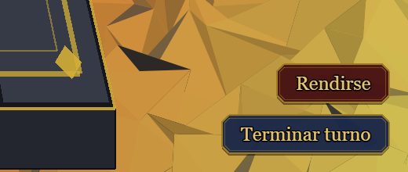
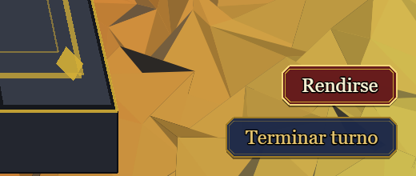
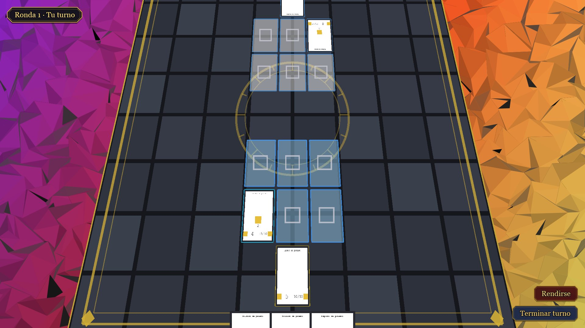

# Fantasy

**HUD:** Dark plates with cut corners and a double gold border that lights up under the pointer, with serif type. **Battlefield:** A floor of stone slabs with a gold inlay and a rune circle in the middle.

The code is in `hud.ts` and `battlefield.ts`. Name in `docs/skins/prototype/registry.ts`: `fantasy`. The HUD was recorded as `fantasia`.

# HUD

## Text

- Georgia, 24 px, regular, with a black outline of 3 px.
- Buttons: `#e8c872`, and `#fff6d8` under the pointer.
- Padding of the buttons: 22 px left and right, 10 px top and bottom.

## Buttons

  

- **Shape.** An octagon: a rectangle with its four corners cut 9 px.
- **Shadow.** The same shape, 3 px lower, black at 45%.
- **Fill**, at 96%: primary `#1d2a4a`, destructive `#4a1414`, neutral `#2b2b30`.
- **Border.** 2 px, `#9c7a26`.
- **Inner line.** 4 px inside the border, with corners cut 5.4 px, 1 px of `#d4af37` at 30%.
- **Under the pointer.** The border goes to `#f5d77a` and the inner line to 90%. The fill of the primary and neutral buttons goes halfway to `#3a4a70`; the destructive one gets `#7a1f1f` at 60% over it.

## Turn panel

- The shape of the buttons with its corners cut 16 px, fill `#14141c` at 95%, and a shadow 5 px lower, black at 50%.
- Border of 2.5 px of `#d4af37`, and an inner line 6 px inside it, 1 px of `#d4af37` at 50%, with corners cut 9.6 px.
- Text `#f5d77a` on the turn of the local player, `#d9d2c0` otherwise.

## Dialog

- The panel of the turn, at 520 by 200 px.
- Question in `#d9d2c0`. "Sí" uses the destructive button, "No" the neutral one.

# Battlefield

- **Bands.** 70 units under the left and right edges in `#1c1e25`, and under the near edge in `#23262f`, all with an outline of 2 units of `#0d0e12`.
- **Mortar.** The whole board in `#15171c`.
- **Slabs.** A grid of 8 by 8 slabs, each one 4% of its side smaller on every edge, so the mortar shows between them. Each slab takes one of `#353a46`, `#30343f`, `#3a3f4c` and `#2d313b`, chosen at random and always the same for the same slab.
- **Gold inlay.** A square at 0.94 `h` from the middle, 6 units of `#d4af37` at 75%, and another at 0.9 `h`, 2 units at 50%. A gold diamond at 90%, 0.03 `h` from its center to each tip, at each corner, centered at 0.92 `h`.
- **Rune circle.** Centered on the middle: a ring of radius 0.32 `h`, 5 units of `#d4af37` at 45%, and one of 0.27 `h`, 2 units at 35%. Between them, 16 radial ticks of 3 units at 40%, alternately from 0.27 and from 0.29 `h` to 0.32 `h`.
- **Outline.** 3 units of `#d4af37` at 90% on the edge of the board.
