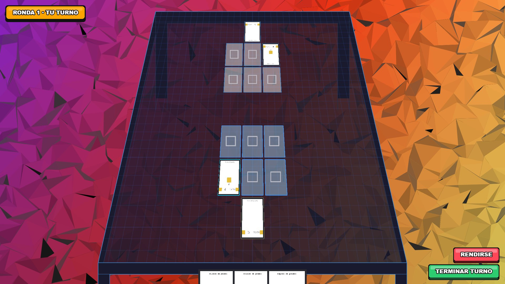
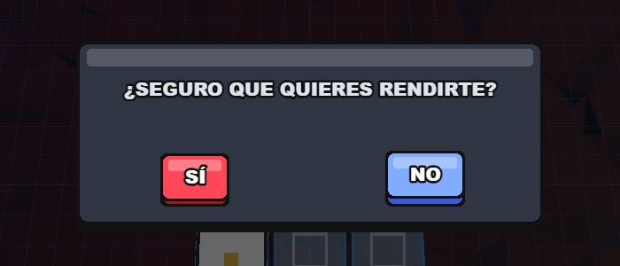
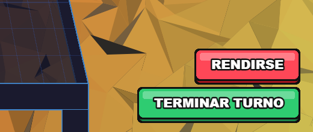

# Arcade blocks

Arcade blocks with depth and a thick black outline, whose top face rises under the pointer, with heavy capitals.

The code is in `hud.ts`. Every part of the HUD is drawn with the base pieces of `FX-17`: the turn panel with the HUD panel and the label text, the end turn button with the primary button, the surrender button and "Sí" with the destructive one, "No" with the neutral one, and the confirmation dialog with the notice panel and the body text. The other parts of the HUD of `FX-10` will use the same pieces.

Name in `docs/skins/prototype/registry.ts`: `arcade-blocks`. The HUD was recorded as `bloque3d`.

## Text levels

| Level | Typeface | Size | Other |
|---|---|---|---|
| Title | Arial Black | 40 px | Capitals, outline of 6 px of `#111111` |
| Body | Arial Black | 21 px | Capitals, outline of 5 px of `#111111` |
| Label | Arial Black | 21 px | Capitals, outline of 5 px of `#111111` |
| Numbers | Arial Black | 22 px | Outline of 5 px of `#111111` |

## Accent colors

- Turn of the local player white, positive `#2ecc71`, negative `#ff4757`, disabled `#747d8c`.

The title and numbers levels and the positive, negative and disabled accents were proposed on 2026-11-15 and are not used by any part yet.

## Panels

 

- **Block** with corners rounded 10 px, an outline of 4 px of `#111111` and a black depth of 8 px; a shine 8 px inside the sides and 5 px below the top edge, 25% of the height and 20 px at most, white at 18%.
- **HUD panel** with the face `#57606f`, and `#ffa502` when highlighted. **Notice panel** with the face `#2f3542`.
- Text `#dfe4ea`. Padding 22 px left and right, 9 px top, 11 px bottom.

## Buttons

  

| Button | Top face | Depth |
|---|---|---|
| Primary | `#2ecc71` | `#1e8449` |
| Destructive | `#ff4757` | `#a4161f` |
| Neutral | `#70a1ff` | `#3b5bdb` |

- **Top face** with corners rounded 8 px, and the **depth**, the same shape 6 px lower behind it, both with an outline of 3 px of `#111111`.
- **Shine.** A rectangle with corners rounded 4 px, 6 px inside the sides and 4 px below the top edge, 28% of the height, white at 30%.
- **Text** white. Padding 22 px left and right, 9 px top, 11 px bottom.
- **Under the pointer.** The top face, its shine and the text rise 3 px, so the depth seen grows to 9 px, and the top face moves 12% towards white. The bottom edge of the depth stays where it was.
