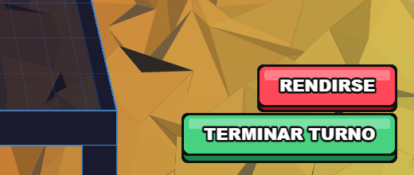
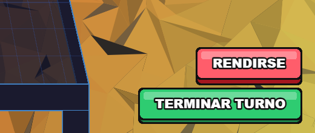

# Arcade blocks

Arcade blocks with depth and a thick black outline, whose top face rises under the pointer, with heavy capitals.

The code is in `hud.ts`. Name in `docs/skins/prototype/registry.ts`: `arcade-blocks`. The HUD was recorded as `bloque3d`.

## Text

- Arial Black, 21 px, in capitals, white with an outline of 5 px of `#111111`.
- Padding of the buttons: 22 px left and right, 9 px top, 11 px bottom.

## Buttons

  

| Kind | Top face | Depth |
|---|---|---|
| Primary | `#2ecc71` | `#1e8449` |
| Destructive | `#ff4757` | `#a4161f` |
| Neutral | `#70a1ff` | `#3b5bdb` |

- **Top face.** A rectangle with corners rounded 8 px.
- **Depth.** The same rectangle, 6 px lower, drawn behind the top face, so a band of 6 px is seen under it.
- **Outline.** 3 px of `#111111` around the top face and around the depth.
- **Shine.** A rectangle with corners rounded 4 px, 6 px inside the sides and 4 px below the top edge, 28% of the height of the button, white at 30%.
- **Under the pointer.** The top face, its shine and the text rise 3 px, so the depth seen grows to 9 px, and the top face moves 12% towards white. The bottom edge of the depth stays where it was.

## Turn panel

- A block with corners rounded 10 px, an outline of 4 px of `#111111` and a black depth of 8 px.
- Face `#ffa502` on the turn of the local player, `#57606f` otherwise.
- Shine 8 px inside the sides and 5 px below the top edge, 25% of the height and 20 px at most, white at 18%.
- Text white on the turn of the local player, `#dfe4ea` otherwise.

## Dialog

- The block of the turn panel in `#2f3542`, at 520 by 200 px.
- Question in `#dfe4ea`, in capitals. "Sí" uses the destructive button, "No" the neutral one.
