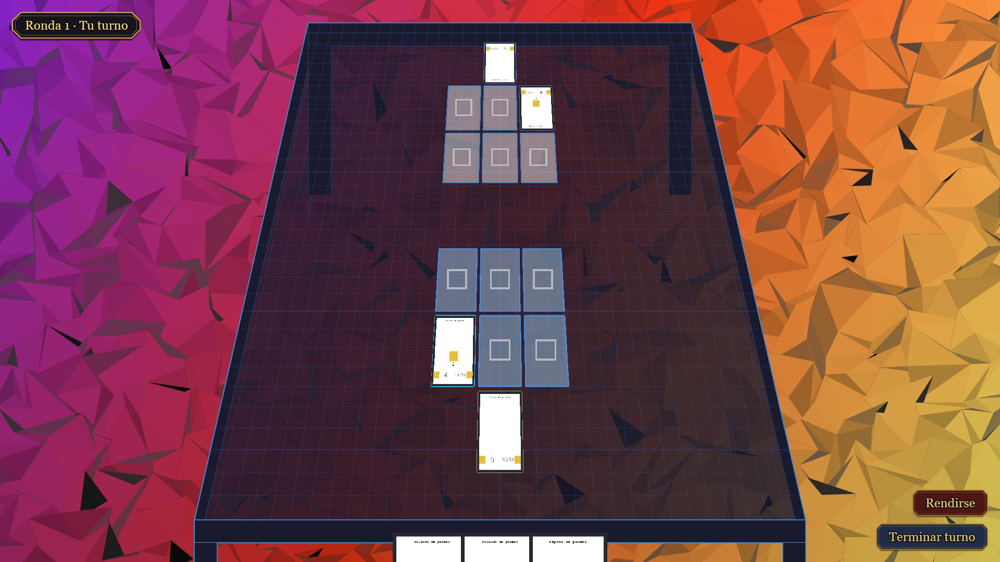
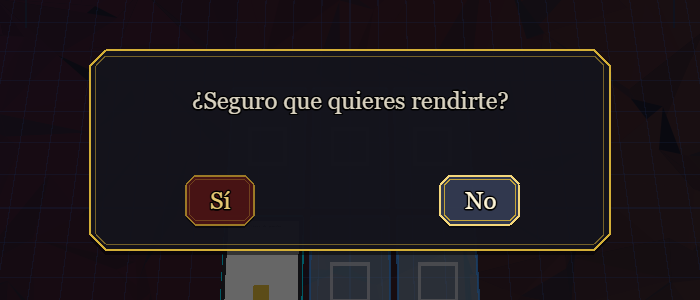
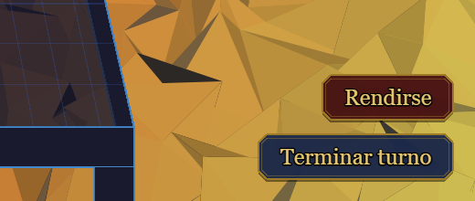
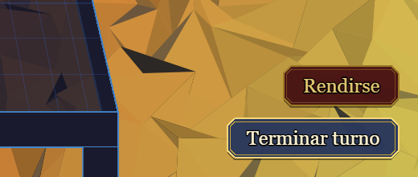
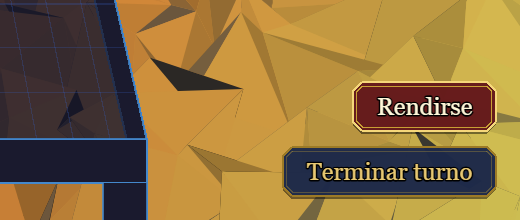

# Fantasy

Dark plates with cut corners and a double gold border that lights up under the pointer, with serif type.

The code is in `hud.ts`. Every part of the HUD is drawn with the base pieces of `FX-17`: the turn panel with the HUD panel and the label text, the end turn button with the primary button, the surrender button and "Sí" with the destructive one, "No" with the neutral one, and the confirmation dialog with the notice panel and the body text. The other parts of the HUD of `FX-10` will use the same pieces.

Name in `docs/skins/prototype/registry.ts`: `fantasy`. The HUD was recorded as `fantasia`.

## Text levels

| Level | Typeface | Size | Weight | Other |
|---|---|---|---|---|
| Title | Georgia | 40 px | Bold | Black outline of 4 px |
| Body | Georgia | 24 px | Regular | Black outline of 3 px |
| Label | Georgia | 24 px | Regular | Black outline of 3 px |
| Numbers | Georgia | 24 px | Bold | Black outline of 3 px |

## Accent colors

- Turn of the local player `#f5d77a`, positive `#8fce5a`, negative `#e05a4a`, disabled `#7a7468`.

The title and numbers levels and the positive, negative and disabled accents were proposed on 2026-11-15 and are not used by any part yet.

## Panels

 

- **HUD panel and notice panel**, the same: an octagon, a rectangle with its corners cut 16 px, fill `#14141c` at 95%, and a shadow of the same shape 5 px lower, black at 50%. Border of 2.5 px of `#d4af37`, and an inner line 6 px inside it, 1 px of `#d4af37` at 50%, with corners cut 9.6 px. The highlight looks the same.
- Text `#d9d2c0`. Padding 22 px left and right, 10 px top and bottom.

## Buttons

  

- **Shape.** An octagon with its corners cut 9 px, and a shadow of the same shape 3 px lower, black at 45%.
- **Fill**, at 96%: primary `#1d2a4a`, destructive `#4a1414`, neutral `#2b2b30`.
- **Border** of 2 px of `#9c7a26`, and an inner line 4 px inside, with corners cut 5.4 px, 1 px of `#d4af37` at 30%.
- **Text** `#e8c872`, and `#fff6d8` under the pointer. Padding 22 px left and right, 10 px top and bottom.
- **Under the pointer.** The border goes to `#f5d77a` and the inner line to 90%. The fill of the primary and neutral buttons goes halfway to `#3a4a70`; the destructive one gets `#7a1f1f` at 60% over it.
