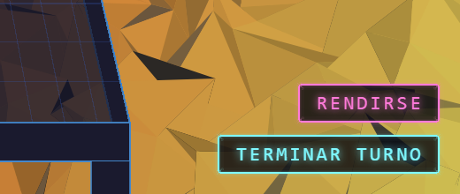
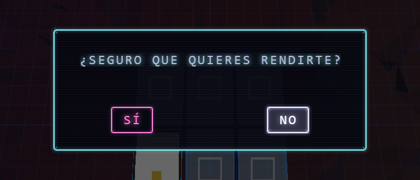

# Neon

Dark glass with a glowing outline that grows stronger under the pointer, and spaced monospaced capitals.

The code is in `hud.ts`. Name in `docs/skins/prototype/registry.ts`: `neon`.

## Text

- Consolas, 22 px, in capitals, with 3 px between letters.
- A glow around the letters, 10 px of blur, without offset: the color of the text on the buttons, and `#7ff9ff` on the turn panel and the question of the dialog.
- Buttons: primary `#7ff9ff`, destructive `#ff7ad9`, neutral `#c9c9ff`. Under the pointer the text goes to white, and the glow keeps its color.
- Padding of the buttons: 20 px left and right, 10 px top and bottom.

## Buttons

  

The color of a button is the color of its text.

- **Glass.** A rectangle with corners rounded 3 px, `#05060f` at 80%.
- **Glow.** Three strokes of its color around the edge: 12 px at 6%, 7 px at 12% and 4 px at 25%, all of them multiplied by 45% at rest.
- **Line.** 1.5 px of its color on the edge.
- **Under the pointer.** The glow goes to 100% of those values, the glass is tinted towards 25% of its color, and the line moves 60% towards white.

## Turn panel

- Glass `#05060f` at 88%, with corners rounded 4 px.
- Scan lines: a white line of 1 px at 3.5% every 4 px.
- Glow of two strokes, 12 px at 5% and 6 px at 12%, and a line of 1.5 px.
- Color `#7ff9ff` on the turn of the local player, `#8888bb` otherwise. Text `#7ff9ff` on the turn of the local player, `#b8b8d8` otherwise.

## Dialog

- The turn panel, in `#7ff9ff`, at 520 by 200 px.
- Question in `#b8b8d8`, in capitals. "Sí" uses the destructive button, "No" the neutral one.
