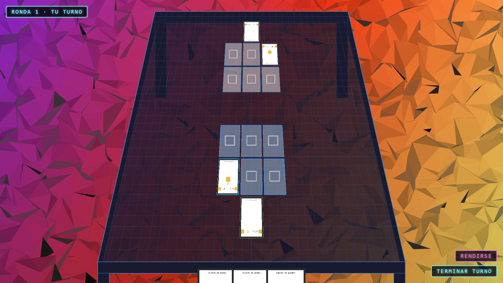
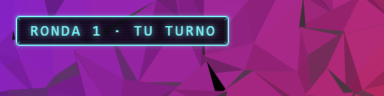
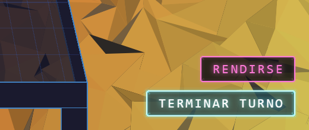
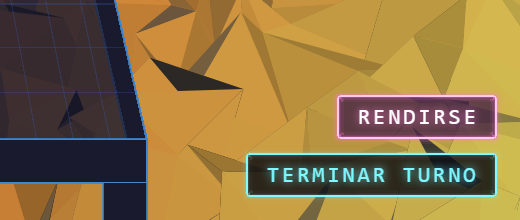

# Neon

Dark glass with a glowing outline that grows stronger under the pointer, and spaced monospaced capitals.

The code is in `hud.ts`. Every part of the HUD is drawn with the base pieces of `FX-17`: the turn panel with the HUD panel and the label text, the end turn button with the primary button, the surrender button and "Sí" with the destructive one, "No" with the neutral one, and the confirmation dialog with the notice panel and the body text. The other parts of the HUD of `FX-10` will use the same pieces.

Name in `docs/skins/prototype/registry.ts`: `neon`.

## Text levels

| Level | Typeface | Size | Other |
|---|---|---|---|
| Title | Consolas | 40 px | Capitals, 4 px between letters |
| Body | Consolas | 22 px | Capitals, 3 px between letters |
| Label | Consolas | 22 px | Capitals, 3 px between letters |
| Numbers | Consolas | 22 px | |

Every text has a glow around its letters, 10 px of blur, without offset: the color of its button, or `#7ff9ff` on the panels.

## Accent colors

- Turn of the local player `#7ff9ff`, positive `#7aff9a`, negative `#ff5a7a`, disabled `#5a5a7a`.

The title and numbers levels and the positive, negative and disabled accents were proposed on 2026-11-15 and are not used by any part yet.

## Panels

 

- **Glass** `#05060f` at 88%, with corners rounded 4 px, and scan lines: a white line of 1 px at 3.5% every 4 px.
- **Outline** of its color: glows of 12 px at 5% and 6 px at 12%, and a line of 1.5 px.
- **HUD panel** in `#8888bb`, and in `#7ff9ff` when highlighted. **Notice panel** always in `#7ff9ff`.
- Text `#b8b8d8`. Padding 20 px left and right, 10 px top and bottom.

## Buttons

  

- **Color**: primary `#7ff9ff`, destructive `#ff7ad9`, neutral `#c9c9ff`. It is the color of the text, of its glow and of the outline.
- **Glass.** A rectangle with corners rounded 3 px, `#05060f` at 80%.
- **Outline.** Three strokes of its color, 12 px at 6%, 7 px at 12% and 4 px at 25%, all of them at 45% at rest, and a line of 1.5 px.
- Padding 20 px left and right, 10 px top and bottom.
- **Under the pointer.** The strokes go to 100% of their values, the glass is tinted towards 25% of its color, the line moves 60% towards white and the text goes to white.
