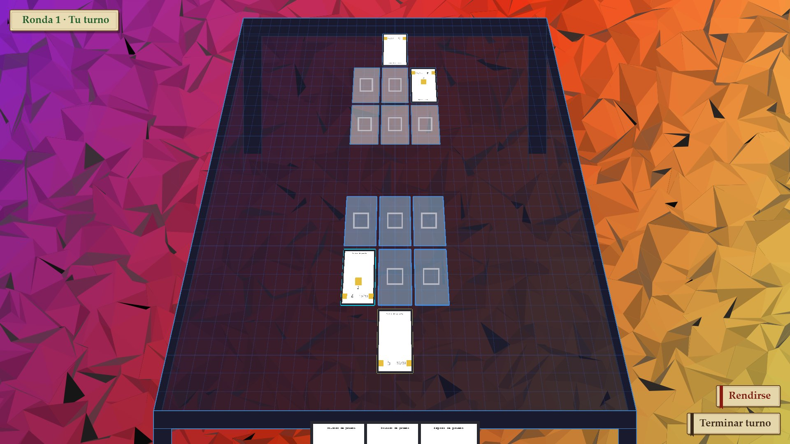
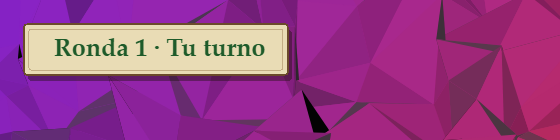
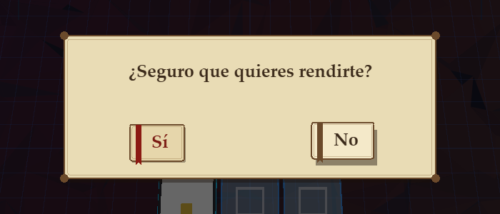
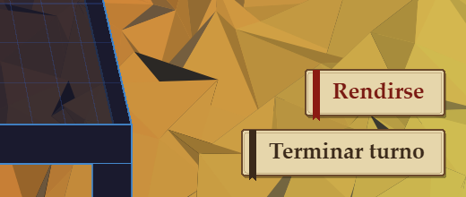
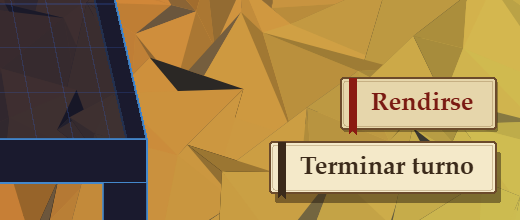
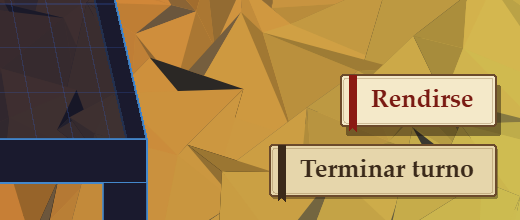

# Parchment

Notes of aged paper with a ribbon, that rise from the table under the pointer.

The code is in `hud.ts`. Every part of the HUD is drawn with the base pieces of `FX-17`: the turn panel with the HUD panel and the label text, the end turn button with the primary button, the surrender button and "Sí" with the destructive one, "No" with the neutral one, and the confirmation dialog with the notice panel and the body text. The other parts of the HUD of `FX-10` will use the same pieces.

Name in `docs/skins/prototype/registry.ts`: `parchment`. The HUD was recorded as `pergamino`.

## Text levels

| Level | Typeface | Size | Weight |
|---|---|---|---|
| Title | Palatino Linotype | 40 px | Bold |
| Body | Palatino Linotype | 25 px | Bold |
| Label | Palatino Linotype | 25 px | Bold |
| Numbers | Palatino Linotype | 25 px | Bold |

## Accent colors

- Turn of the local player `#1e5b2a`, positive `#2e6b2a`, negative `#8b1a12`, disabled `#8a7a60`.

The title and numbers levels and the positive, negative and disabled accents were proposed on 2026-11-15 and are not used by any part yet.

## Panels

 

- **HUD panel.** Paper `#e9dcb5` with corners rounded 4 px and a border of 2 px of `#6b4a2b`; an aged edge 5 px inside, 1 px of `#8a6a3b` at 40%; and a shadow 4 px to the right and 6 px lower, `#1a1008` at 40%. The highlight looks the same.
- **Notice panel.** The HUD panel with a circle of 6 px of radius of `#6b4a2b` on each corner, like pins.
- Text `#3b2a1a`. Padding 30 px left, 22 px right, 10 px top, 12 px bottom.

## Buttons

  

- **Paper.** A rectangle with corners rounded 3 px, `#e6d6ab`, with a border of 2 px of `#6b4a2b` and an aged edge 3 px inside, with corners rounded 2 px, 1 px of `#8a6a3b` at 35%.
- **Shadow.** The rectangle at rest, 2 px to the right and 3 px lower, `#1a1008` at 35%.
- **Ribbon.** A vertical strip 8 px wide, 8 px from the left edge, from the top edge to 6 px below the bottom one, ending in a notch 4 px deep: primary `#3b2a1a`, destructive `#8b1a12`, neutral `#6b4a2b`.
- **Text** `#3b2a1a`; the destructive one `#7a1a12`. It does not change under the pointer. Padding 30 px left, 22 px right, 10 px top, 12 px bottom.
- **Under the pointer.** The paper, the ribbon and the text rise 3 px, and the paper lightens to `#f4e9c9`. The shadow stays where the paper was at rest, moves to 5 px to the right and 7 px lower, and goes to 45%.
