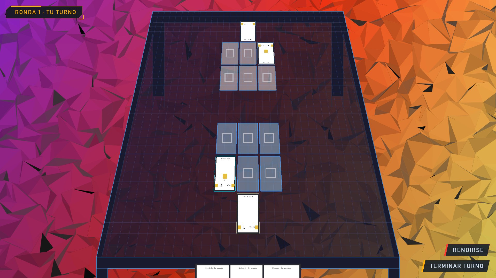
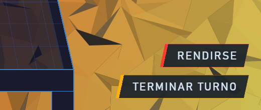
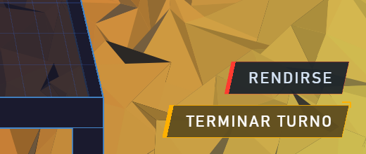
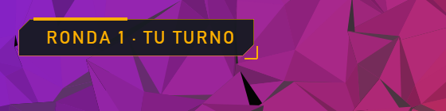
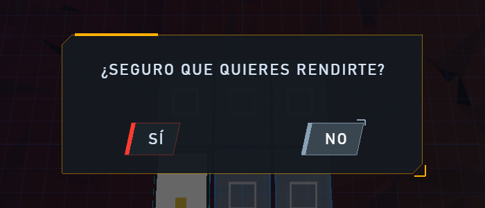

# Sci-fi

Slanted plates with an accent bar that sweeps across under the pointer, corner brackets and capitals.

The code is in `hud.ts`. Name in `docs/skins/prototype/registry.ts`: `sci-fi`. The HUD was recorded as `scifi`.

## Text

- Bahnschrift, 22 px, in capitals, with 2 px between letters.
- Buttons: `#d6e4f5`, and white under the pointer.
- Padding of the buttons: 34 px left, 24 px right, 10 px top and bottom.

## Buttons

  

The accent color: primary `#ffb000`, destructive `#ff3b30`, neutral `#8aa0b4`.

- **Shape.** A parallelogram slanted to the right: the top edge starts 10 px to the right of the bottom one, and the bottom edge ends 10 px to the left of the top one.
- **Fill.** `#1c232b` at 94%.
- **Accent bar.** A parallelogram with the same slant on the left edge, 6 px wide, in the accent color.
- **Outline.** 1 px of the accent color at 35%.
- **Under the pointer.** The accent sweeps from the bar to the right edge, filling the button with the accent color at 28%. The outline goes to 85%. A corner bracket of 2 px of the accent color fades in over the top right corner: its corner is 2 px to the right of it and 4 px above it, with an arm of 12 px to the left and one of 8 px down.

## Turn panel

- A rectangle with its top left and bottom right corners cut 14 px, fill `#141a20` at 94%, and an outline of 1 px of the accent color at 50%.
- An accent bar 4 px tall over the top edge, starting 18 px from the left, 120 px long or 40% of the width if it is shorter.
- A corner bracket of 2 px with arms of 16 px, its corner 4 px to the right of and 4 px below the bottom right corner.
- Accent `#ffb000` on the turn of the local player, `#8aa0b4` otherwise. Text `#ffb000` on the turn of the local player, `#d6e4f5` otherwise.

## Dialog

- The turn panel at 520 by 200 px, with the accent `#ffb000`.
- Question in `#d6e4f5`, in capitals. "Sí" uses the destructive button, "No" the neutral one.
