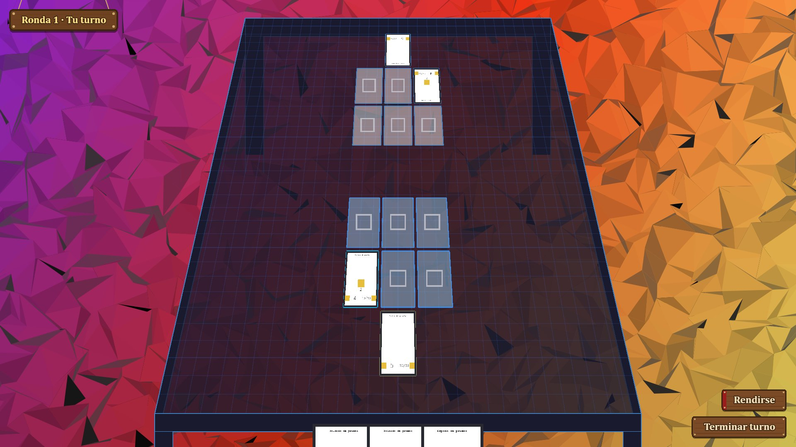
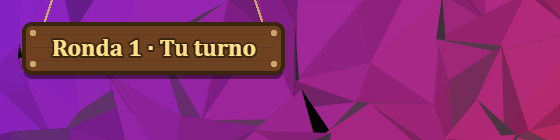
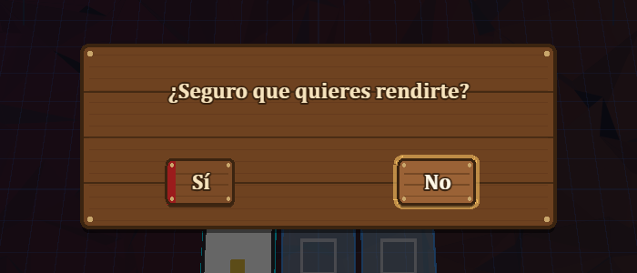
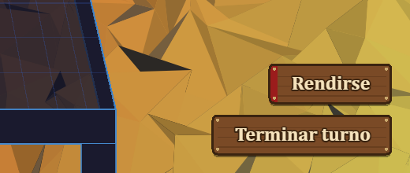
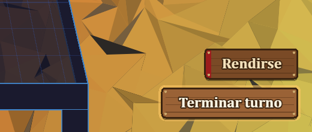
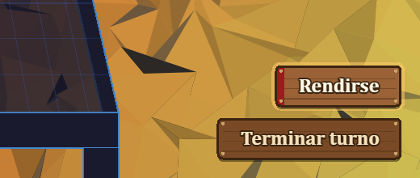

# Wood

Wooden signs with grain and nails, a warm glow under the pointer, and the turn hanging from two ropes.

The code is in `hud.ts`. Every part of the HUD is drawn with the base pieces of `FX-17`: the turn panel with the HUD panel and the label text, the end turn button with the primary button, the surrender button and "Sí" with the destructive one, "No" with the neutral one, and the confirmation dialog with the notice panel and the body text. The other parts of the HUD of `FX-10` will use the same pieces.

Name in `docs/skins/prototype/registry.ts`: `wood`. The HUD was recorded as `madera`.

## Text levels

| Level | Typeface | Size | Weight | Other |
|---|---|---|---|---|
| Title | Cambria | 40 px | Bold | Outline of 5 px of `#3b2410` |
| Body | Cambria | 24 px | Bold | Outline of 4 px of `#3b2410` |
| Label | Cambria | 24 px | Bold | Outline of 4 px of `#3b2410` |
| Numbers | Cambria | 24 px | Bold | Outline of 4 px of `#3b2410` |

## Accent colors

- Turn of the local player `#ffe08a`, positive `#9ad46a`, negative `#d9534f`, disabled `#8a7a66`.

The title and numbers levels and the positive, negative and disabled accents were proposed on 2026-11-15 and are not used by any part yet.

## Panels

 

- **Board** `#6e4220` with corners rounded 8 px, a border of 4 px of `#3b2410` and a shadow 6 px lower, black at 45%. Grain: a line of 1.2 px of `#5a3418` at 45% every 13 px, from 10 px below the top edge, 8 px from the sides. Nails: a circle of 3 px of radius of `#c9a66b` 9 px from each corner.
- **HUD panel.** A single plank hanging from two ropes of 2 px of `#c9a66b`, from the top edge, 20 px inside each corner, up 30 px and 10 px further inside. The highlight looks the same.
- **Notice panel.** Without ropes, split in four planks by three lines of 2 px of `#3b2410` at 80%.
- Text `#f6e3bd`. Padding 26 px left, 24 px right, 10 px top and bottom.

## Buttons

  

- **Plank** with corners rounded 6 px, `#7a4a26`, with a border of 3 px of `#3b2410` and a shadow 4 px lower, black at 40%.
- **Grain.** Three lines of 1.5 px of `#5a3418` at 55%, at 30%, 55% and 80% of the height, 6 px from the sides. **Nails.** A circle of 2.2 px of radius of `#c9a66b` 6 px from each corner.
- **Destructive.** A red band of `#9b1c1c`, 10 px wide, on the left edge. The primary and neutral buttons have none.
- **Text** `#f6e3bd`, and `#fff8e6` under the pointer. Padding 26 px left, 24 px right, 10 px top and bottom.
- **Under the pointer.** The plank lightens to `#9a6236`, and a warm glow, a stroke of 5 px of `#ffc966` at 55% with corners rounded 8 px, appears 3 px outside its edge.
