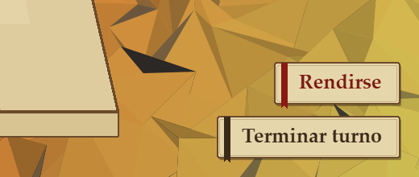
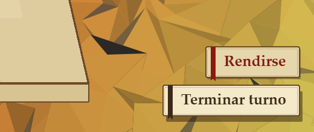
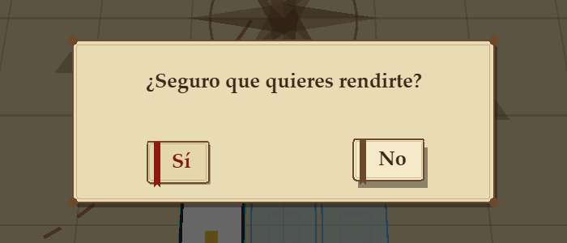
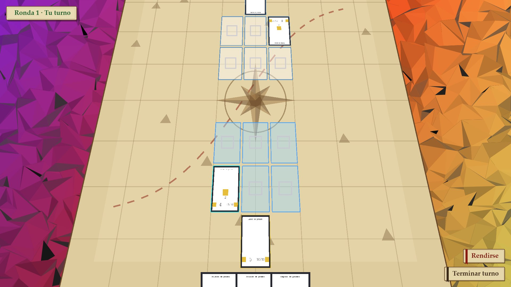

# Parchment

**HUD:** Notes of aged paper with a ribbon, that rise from the table under the pointer. **Battlefield:** A campaign map spread on the ground, with a compass rose, mountains and a dashed route.

The code is in `hud.ts` and `battlefield.ts`. Name in `docs/skins/prototype/registry.ts`: `parchment`. The HUD was recorded as `pergamino`.

# HUD

## Text

- Palatino Linotype, 25 px, bold, without outline.
- Buttons: `#3b2a1a`; the destructive one `#7a1a12`. It does not change under the pointer.
- Padding of the buttons: 30 px left, 22 px right, 10 px top, 12 px bottom.

## Buttons

  

- **Paper.** A rectangle with corners rounded 3 px, `#e6d6ab`, with a border of 2 px of `#6b4a2b`.
- **Aged edge.** A line 3 px inside the border, with corners rounded 2 px, 1 px of `#8a6a3b` at 35%.
- **Shadow.** The rectangle at rest, 2 px to the right and 3 px lower, `#1a1008` at 35%.
- **Ribbon.** A vertical strip 8 px wide, 8 px from the left edge, from the top edge to 6 px below the bottom one, ending in a notch 4 px deep. Primary `#3b2a1a`, destructive `#8b1a12`, neutral `#6b4a2b`.
- **Under the pointer.** The paper, the ribbon and the text rise 3 px. The paper lightens to `#f4e9c9`. The shadow stays where the paper was at rest, moves to 5 px to the right and 7 px lower, and goes to 45%.

## Turn panel

- Paper `#e9dcb5` with corners rounded 4 px and a border of 2 px of `#6b4a2b`.
- Aged edge 5 px inside, 1 px of `#8a6a3b` at 40%.
- Shadow 4 px to the right and 6 px lower, `#1a1008` at 40%.
- Text `#1e5b2a` on the turn of the local player, `#3b2a1a` otherwise.

## Dialog

- The paper of the turn panel at 520 by 200 px, with a circle of 6 px of radius of `#6b4a2b` on each corner, like pins.
- Question in `#3b2a1a`. "Sí" uses the destructive button, "No" the neutral one.

# Battlefield

- **Bands.** The map rolled at its edges: 12 units under the left and right edges in `#cbb684`, and 28 units under the near edge in `#d8c393`, all with an outline of 2 units of `#6b4a2b`.
- **Paper.** The whole board in `#e4d3a6`, aged along its edges: a border 0.15 `h` wide inside the edge, of `#b89a62` at 12%, made of five frames of 0.03 `h` side by side, darker on the corners where the sides of each frame overlap.
- **Grid.** Lines every 0.25 `h` in both directions, 2 units of `#6b4a2b` at 22%.
- **Mountains.** Up to 14 triangles of `#6b4a2b` at 35%, 0.07 `h` wide and 0.056 `h` tall, at random places within 0.85 `h` of the middle, always the same; those within 0.35 `h` of the middle are left out.
- **Route.** A dashed line of 4 units of `#8b1a12` at 50%, from `(-0.8 h, 0.6 h)` to `(0.7 h, -0.7 h)`, waving 0.15 `h` to each side, in 20 dashes as long as the gaps between them.
- **Compass rose.** A ring of radius 0.2 `h`, 3 units of `#6b4a2b` at 50%, and eight points from the middle: the four of the cardinal directions 0.26 `h` long, the other four 0.14 `h`, all 0.08 `h` wide at the middle. Each point has a dark half of `#6b4a2b` and a light half of `#a07c4a`, both at 55%.
- **Outline.** 3 units of `#6b4a2b` on the edge of the board.
