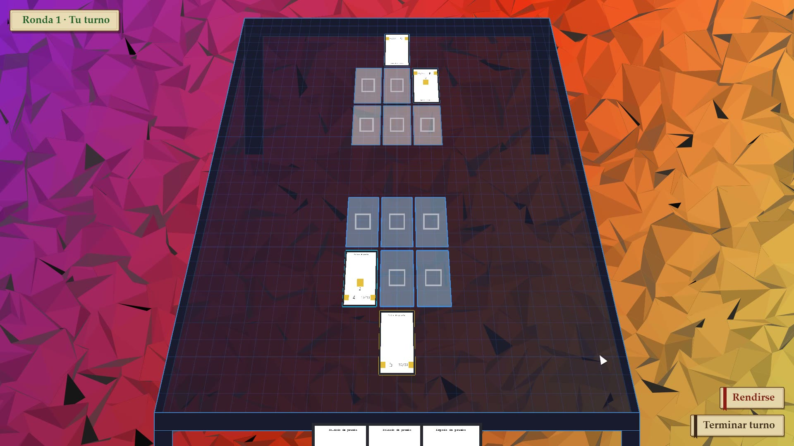
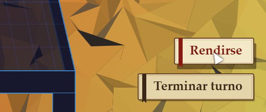

# Parchment

Notes of aged paper with a ribbon, that rise from the table under the pointer. Prototype name: `parchment` (`pergamino` in the recordings).

## Text

- Palatino Linotype, 25 px, bold, without outline.
- Buttons: `#3b2a1a`; the destructive one `#7a1a12`. It does not change under the pointer.
- Padding of the buttons: 30 px left, 22 px right, 10 px top, 12 px bottom.

## Buttons

  

- **Paper.** A rectangle with corners rounded 3 px, `#e6d6ab`, with a border of 2 px of `#6b4a2b`.
- **Aged edge.** A line 3 px inside the border, with corners rounded 2 px, 1 px of `#8a6a3b` at 35%.
- **Shadow.** The rectangle at rest, 2 px to the right and 3 px lower, `#1a1008` at 35%.
- **Ribbon.** A vertical strip 8 px wide, 8 px from the left edge, from the top edge to 6 px below the bottom one, ending in a notch 4 px deep. Primary `#3b2a1a`, destructive `#8b1a12`, neutral `#6b4a2b`.
- **Under the pointer.** The paper, the ribbon and the text rise 3 px. The paper lightens to `#f4e9c9`. The shadow stays where the paper was at rest, moves to 5 px to the right and 7 px lower, and goes to 45%.

## Turn panel

- Paper `#e9dcb5` with corners rounded 4 px and a border of 2 px of `#6b4a2b`.
- Aged edge 5 px inside, 1 px of `#8a6a3b` at 40%.
- Shadow 4 px to the right and 6 px lower, `#1a1008` at 40%.
- Text `#1e5b2a` on the turn of the local player, `#3b2a1a` otherwise.

## Dialog

- The paper of the turn panel at 520 by 200 px, with a circle of 6 px of radius of `#6b4a2b` on each corner, like pins.
- Question in `#3b2a1a`. "Sí" uses the destructive button, "No" the neutral one.
