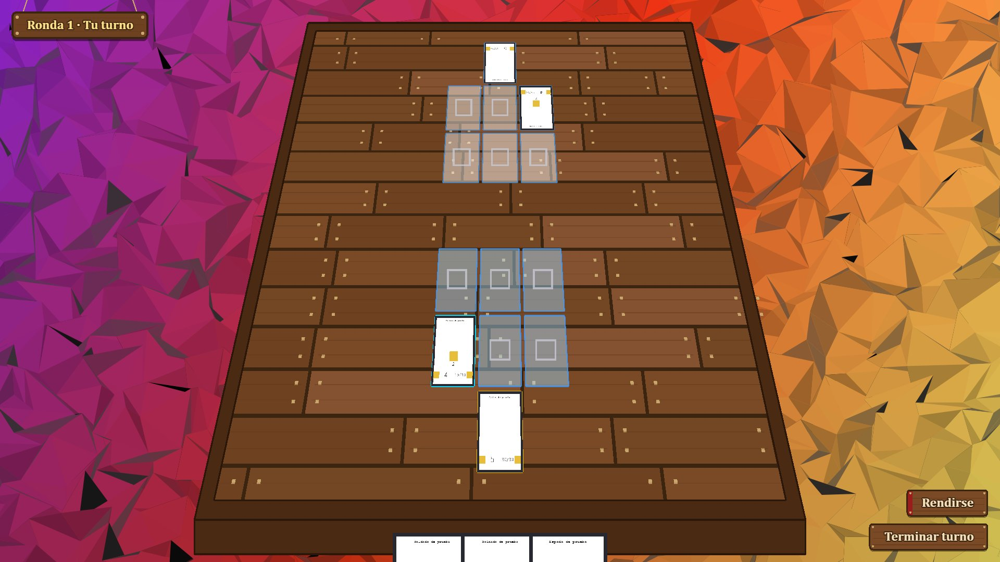
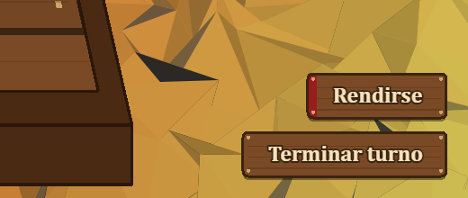
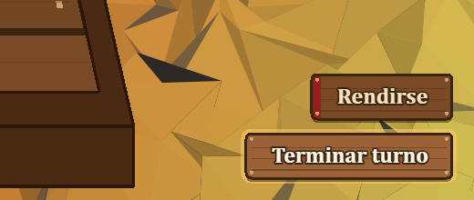
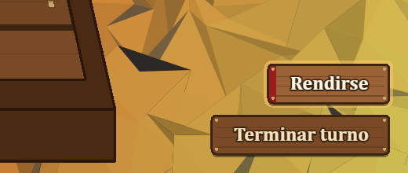
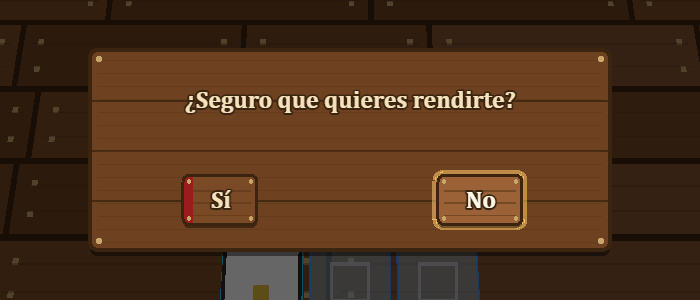
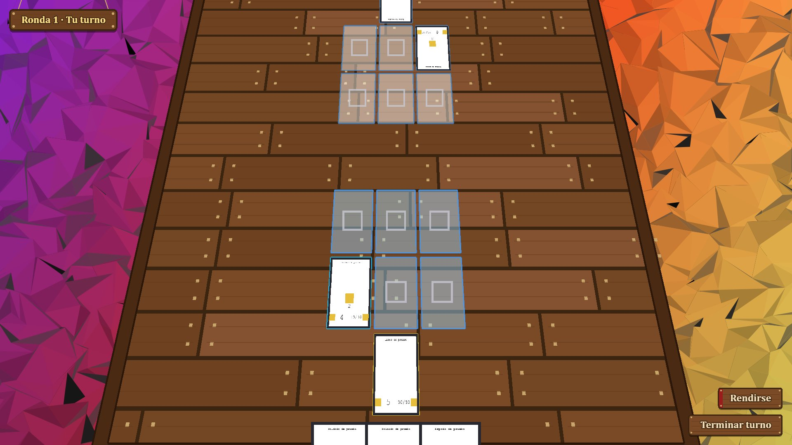

# Wood

**HUD:** Wooden signs with grain and nails, a warm glow under the pointer, and the turn hanging from two ropes. **Battlefield:** A deck of staggered planks with grain and nails, inside a frame of beams.

The code is in `hud.ts` and `battlefield.ts`. Name in `docs/skins/prototype/registry.ts`: `wood`. The HUD was recorded as `madera`.

# HUD

## Text

- Cambria, 24 px, bold, with an outline of 4 px of `#3b2410`.
- Buttons: `#f6e3bd`, and `#fff8e6` under the pointer.
- Padding of the buttons: 26 px left, 24 px right, 10 px top and bottom.

## Buttons

  

- **Plank.** A rectangle with corners rounded 6 px, `#7a4a26`, with a border of 3 px of `#3b2410`.
- **Shadow.** The plank 4 px lower, black at 40%.
- **Grain.** Three lines of 1.5 px of `#5a3418` at 55%, at 30%, 55% and 80% of the height, 6 px from the sides.
- **Nails.** A circle of 2.2 px of radius of `#c9a66b` 6 px from each corner.
- **Destructive.** A red band of `#9b1c1c`, 10 px wide, on the left edge. The primary and neutral buttons have none.
- **Under the pointer.** The plank lightens to `#9a6236`, and a warm glow, a stroke of 5 px of `#ffc966` at 55% with corners rounded 8 px, appears 3 px outside its edge.

## Turn panel

- A board `#6e4220` with corners rounded 8 px, a border of 4 px of `#3b2410` and a shadow 6 px lower, black at 45%.
- Grain: a line of 1.2 px of `#5a3418` at 45% every 13 px, from 10 px below the top edge, 8 px from the sides.
- Nails: a circle of 3 px of radius of `#c9a66b` 9 px from each corner.
- Two ropes of 2 px of `#c9a66b`, from the top edge, 20 px inside each corner, up 30 px and 10 px further inside.
- Text `#ffe08a` on the turn of the local player, `#f6e3bd` otherwise.

## Dialog

- The board of the turn panel at 520 by 200 px, without ropes, split in four planks by three lines of 2 px of `#3b2410` at 80%.
- Question in `#f6e3bd`. "Sí" uses the destructive button, "No" the neutral one.

# Battlefield

- **Bands.** 60 units under the left and right edges in `#3f230f`, and under the near edge in `#4a2a12`, all with an outline of 3 units of `#2a170a`.
- **Seams.** The whole board in `#3b2410`.
- **Planks.** 14 rows across the board, from the far edge to the near one. Each row is split into planks from 0.35 `h` to 0.85 `h` long, at random and always the same; the first one of each row is that length times a random factor from 0.3 to 1.3, so the joints of the rows do not line up. The last one ends at the edge. Each plank is 0.006 `h` smaller on every edge, so the seams show, and takes one of `#7a4a26`, `#6e4220`, `#845230` and `#734624`.
- **Grain.** Two lines along each plank, at a third and two thirds of its width, 1.5 units of `#5a3418` at 35%.
- **Nails.** At each end of a plank, at 30% of the width of the row from the end, two squares of 0.012 `h` of `#c9a66b`, at 30% and 70% of the width of the row.
- **Frame.** A beam of 0.05 `h` of `#4a2a12` along the four edges, with lines of 3 units of `#2a170a` on its inner and outer edge.
